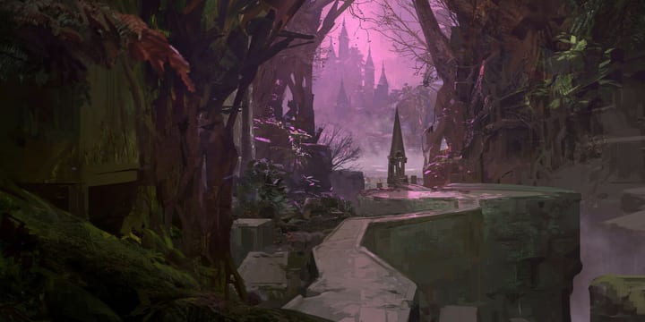
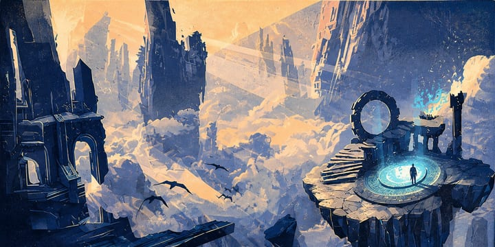
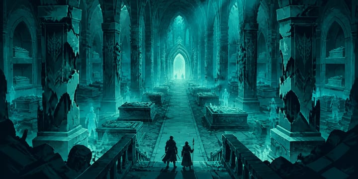
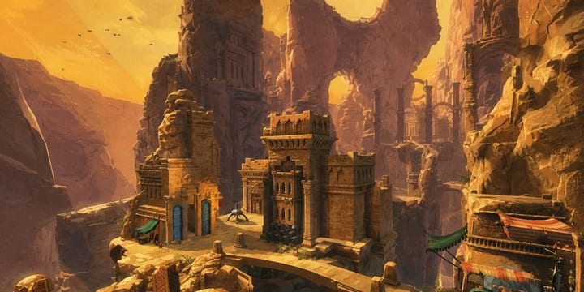
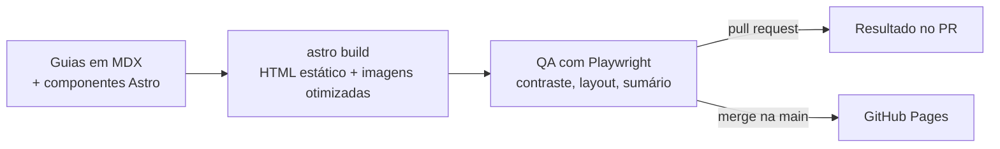

 

<picture>
  <source media="(prefers-color-scheme: dark)" srcset="site-astro/public/readme/logo-escuro.png">
  
</picture>

# Guild DIVINE

**O manual da guilda para o conteúdo em grupo de Guild Wars 2.** 
Raids, Fractals e Dungeons explicados em português, com vídeo de cada boss.

 

&nbsp;&nbsp;

 

## Escolha seu guia

> [!TIP]
> Nunca entrou num squad? Comece pelo **Endgame**. Ele explica boons, roles e builds, que os outros guias já dão por sabidos.

<table>
<tr>
<td width="33%" valign="top">

<a href="https://divinegw.github.io/guias/endgame.html"><b>Endgame</b></a>&nbsp;&nbsp;comece por aqui

O básico antes do primeiro squad: boons, roles e builds.

</td>
<td width="33%" valign="top">

<a href="https://divinegw.github.io/guias/raids.html"><b>Raids</b></a>

Das 8 wings aos Raid Encounters, com vídeo de cada boss e o que muda no CM.

</td>
<td width="33%" valign="top">

<a href="https://divinegw.github.io/guias/fractals.html"><b>Fractals</b></a>

Tiers, Agony Resistance e o Challenge Mode das 7 Fractals que têm um.

</td>
</tr>
<tr>
<td width="33%" valign="top">

<a href="https://divinegw.github.io/guias/dungeons.html"><b>Dungeons</b></a>

As 8 dungeons clássicas de Tyria, com a entrada e um vídeo de cada path.

</td>
<td width="33%" valign="top">

<a href="https://divinegw.github.io/guias/recursos-uteis.html"><b>Recursos Úteis</b></a>

58 sites e ferramentas da comunidade, cada um com o que faz.

</td>
<td width="33%" valign="top">

<a href="https://divinegw.github.io/guias/cursores.html"><b>Divine Prisma</b></a>

Cursores feitos pela guilda, com instalador para o Nexus.

</td>
</tr>
</table>

## Para baixar

| Download | O que vem |
|---|---|
| **[Wallpapers](https://divinegw.github.io/galeria.html)** | As artes dos nossos guias em alta resolução, 3200 px. |
| **[Perfil do Zyanore para o ArcDPS](https://divinegw.github.io/downloads/arcdps-zyanore.zip)** | As janelas de DPS do Zyanore, com a fonte e um passo a passo. O [Endgame](https://divinegw.github.io/guias/endgame.html#arcdps) mostra como instalar. |
| **[Divine Prisma](https://github.com/divinegw/divine-prisma)** | Os cursores, com instalador para o Nexus e versão `.cur` para o YoloMouse. |

## Quer ajudar?

Achou um erro, um boss mudou ou falta um vídeo? Você pode corrigir direto aqui, até pelo navegador. O [guia de contribuição](CONTRIBUTING.md) mostra o caminho mais curto. Prefere só avisar? [Abra uma issue](https://github.com/divinegw/divinegw.github.io/issues/new) ou chame a gente no [Discord](https://discord.gg/7fHMRW2xvt).

## Por dentro do site

<b>Como o site é feito</b>

 

A gente escreve os guias em MDX, com componentes próprios para boss, wing, dungeon e avisos, e o Astro transforma tudo em HTML estático. Quando você abre um pull request, o GitHub Actions gera o site e roda os testes num navegador de verdade (Playwright com Chrome). Depois do merge na `main`, o mesmo fluxo roda de novo e publica no GitHub Pages. Se a build ou um teste falhar, nada vai para o ar.

<b>O que os testes conferem</b>

 

Cada página é testada em 4 combinações: tema claro e escuro, computador e celular.

| Teste | O que ele pega |
|---|---|
| Contraste | Todo texto da página medido contra o fundo real, pela regra WCAG. |
| Layout | Rolagem para o lado, botões pequenos demais para o toque, títulos fora de ordem. |
| Imagens e erros | Imagem quebrada, banner no tamanho errado, erro no console do navegador. |
| Sumário | Clica em cada item de cada guia, com a rolagem suave ligada, e confere se o título parou logo abaixo do cabeçalho. |
| Impressão | Página em branco ou quase vazia ao imprimir em A4. |

<b>Por baixo do capô</b>

 

- O Astro gera cada arte em várias larguras, em WebP, e o navegador baixa só a que cabe na tela.
- As abas seguem o padrão WAI-ARIA e funcionam pelo teclado (setas, Home e End). Toda imagem tem uma descrição do que mostra.
- Os endereços dos guias (`/guias/<guia>.html`) e as âncoras das seções não mudam. A guilda compartilha esses links no Discord, e link quebrado lá ninguém conserta. Os links antigos de PDF (`/pdfs/<guia>.pdf`) abrem um PDF de uma página com o link do guia.

<b>Créditos</b>

 

- **Texto dos guias:** membros da guilda DIVINE. O autor de cada guia aparece no topo dele.
- **Ilustrações:** feitas pela guilda a partir de artes, capturas e telas de carregamento de Guild Wars 2 e de prints tirados no jogo pela guilda e por jogadores da comunidade, mudando só o estilo.
- **Ícones e fontes:** [Lucide](https://lucide.dev) (ISC), Mona Sans e Geist Mono (SIL Open Font License, com as licenças em `site-astro/public/assets/fonts/`).

A lista completa, com cada imagem da Guild Wars 2 Wiki, cada canal de vídeo e cada licença, está na página de [Créditos](https://divinegw.github.io/creditos.html).

 

Guild Wars 2 e todos os nomes, artes e ícones do jogo pertencem à ArenaNet e são usados conforme os <a href="https://www.arena.net/en/legal/content-terms-of-use">Content Terms of Use</a>. Este é um site de fã, sem fins comerciais e sem vínculo com a ArenaNet.

