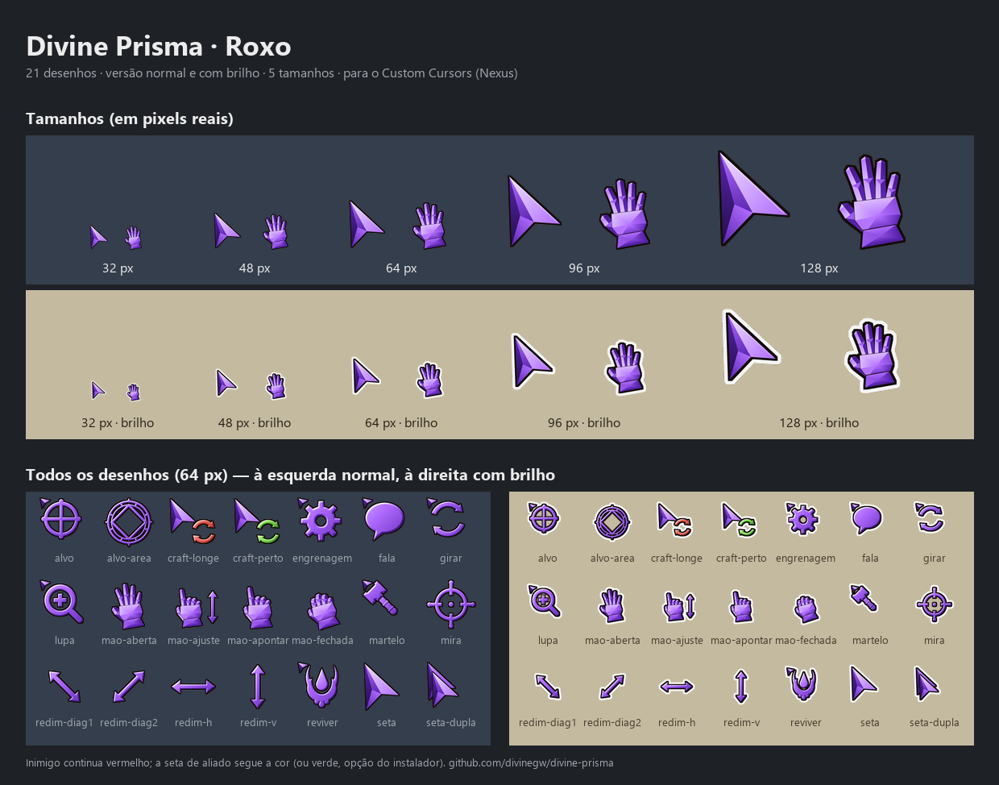
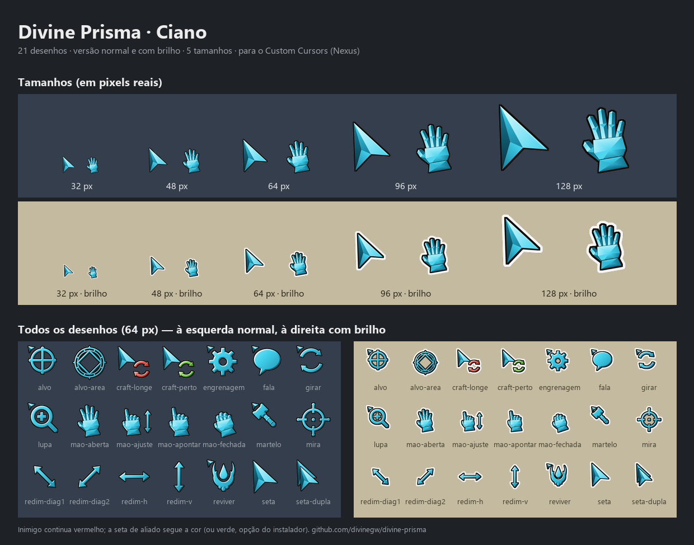
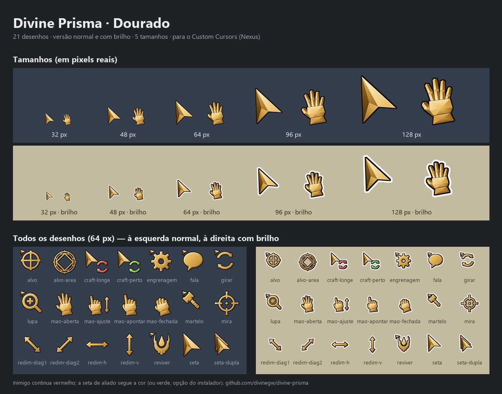
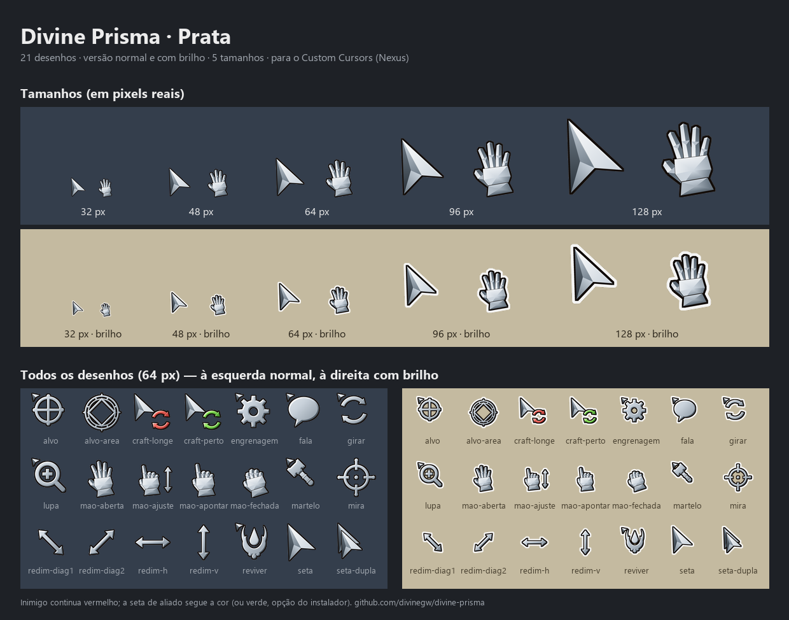
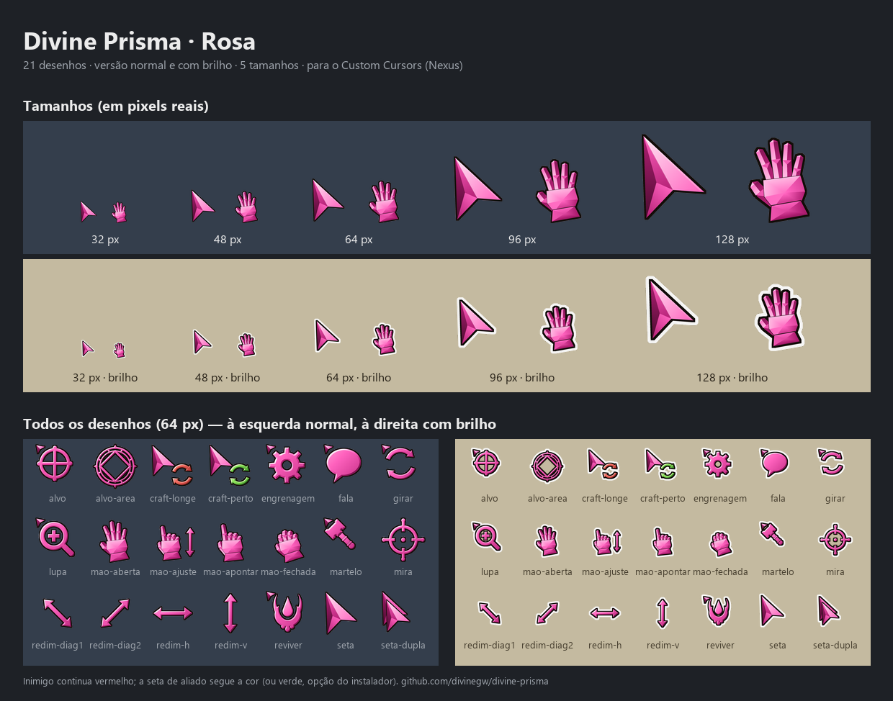
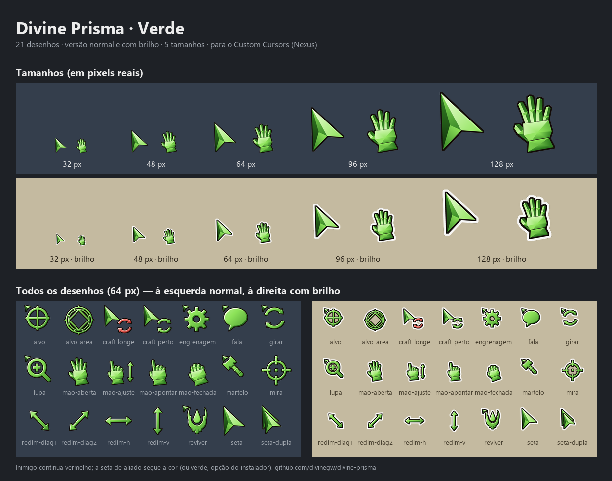
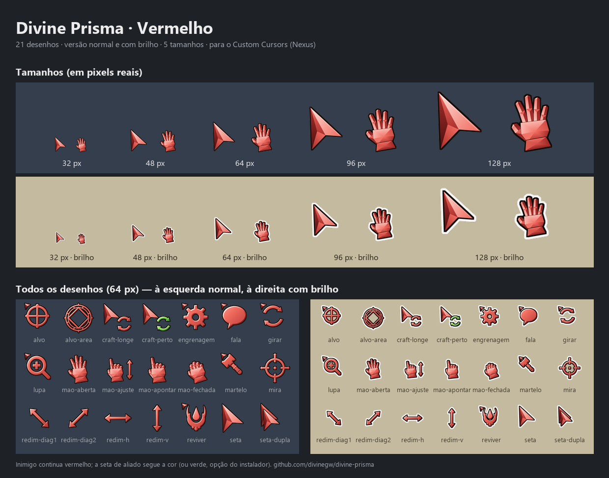

## O que é

Fizemos um pack de cursores para você trocar o cursor do jogo. É da guilda para a comunidade.

<Card icone="mouse-pointer-2">

### Cursores prismáticos

Quer trocar o cursor do jogo por um com a cara da guilda? Os nossos seguem o estilo metálico do jogo e funcionam com o addon **Custom Cursors**, que roda dentro do **Nexus** (o programa que carrega addons no Guild Wars 2). Nós desenhamos tudo por código, então o desenho é original e o pack não usa arquivos de terceiros. Também há uma versão em `.cur` (formato de cursor do Windows) para o **YoloMouse** e outros programas.

<Item icone="shapes">**21 desenhos**: seta, seta dupla, conversar, engrenagem, lupa, martelo, girar, alvo, mira, alvo de área, 4 mãos, 4 setas de redimensionar, reciclar perto/longe e reviver.</Item>
<Item icone="palette">**7 cores**: roxo, ciano, dourado, prata, rosa, verde e vermelho. Todas têm versão normal e versão **com brilho** (borda branca, como o cursor de contraste do jogo).</Item>
<Item icone="ruler">**5 tamanhos**: 32, 48, 64, 96 e 128 px, cada um com o ponto de clique (a ponta que acerta o alvo) no lugar certo.</Item>
<Item icone="crosshair">**Inimigo** continua com a seta vermelha. **Aliado** usa a cor que você escolher, ou o verde do jogo, se preferir.</Item>

<Botao variante="primario" tamanho="lg" href="https://github.com/divinegw/divine-prisma/releases/latest/download/divine-prisma-kit.zip" icone="download">Baixar para o Nexus</Botao>
<Botao tamanho="lg" href="https://github.com/divinegw/divine-prisma/releases/latest/download/divine-prisma-cur.zip" icone="download">Baixar .cur (YoloMouse)</Botao>
<Botao tamanho="lg" href="https://github.com/divinegw/divine-prisma" externo icone="github">Ver no GitHub</Botao>

<Aviso tipo="dica" titulo="Antes se chamava gw2-facetado">Se você já tinha a versão antiga, é só rodar o instalador novo. Ele acha a pasta `gw2-facetado`, troca pela nova e corrige o `settings.json` sozinho.</Aviso>

</Card>

## Cores e desenhos

Veja como cada cor fica antes de instalar: os 21 desenhos nos 5 tamanhos em pixels reais, normal e com brilho.

<Card icone="palette">

### As 7 cores

Escolha a cor nas abas. Cada prévia é a mesma que vai dentro do pack.

<Abas rotulo="Cores dos cursores">
<Aba rotulo="Roxo">

</Aba>
<Aba rotulo="Ciano">

</Aba>
<Aba rotulo="Dourado">

</Aba>
<Aba rotulo="Prata">

</Aba>
<Aba rotulo="Rosa">

</Aba>
<Aba rotulo="Verde">

</Aba>
<Aba rotulo="Vermelho">

</Aba>
</Abas>

</Card>

<Card icone="mouse-pointer-click">

### Quais cursores mudam

Você pode usar o **Contraste do cursor** do jogo (Opções → Geral → Acessibilidade) em três modos: Desligar, Baixo e Alto. Cada modo usa cursores diferentes, e o instalador troca os três. Assim o cursor tem o mesmo tamanho na tela em qualquer um. No modo Alto, por enquanto, só a seta padrão é trocada.

<Item icone="mouse-pointer-2">**Seta padrão** e seta sobre link do chat: na cor que você escolheu.</Item>
<Item icone="swords">**Inimigo**: seta vermelha. **Aliado**: na sua cor ou em verde, como no jogo (opção da janela).</Item>
<Item icone="message-circle">**Conversar** (fala), **interagir** (engrenagem) e **reviver**.</Item>
<Item icone="hand">**Pegar, agarrar e ajustar** (mãos aberta, fechada e de ajuste).</Item>
<Item icone="crosshair">**Mira**, **inspecionar** (lupa) e **reciclar** perto e longe.</Item>
<Item icone="move-diagonal">**Redimensionar** na horizontal, na vertical e nas duas diagonais.</Item>

Os desenhos que o jogo não usa (seta dupla, martelo, girar, alvo, alvo de área, mão de apontar) também vão para a pasta do pack e podem ser escolhidos no menu do Custom Cursors, dentro do jogo. A lista com o número de cada cursor do jogo está no [mapa do instalador, no GitHub](https://github.com/divinegw/divine-prisma/blob/main/kit/_instalador/mapa.json).

</Card>

## Qual tamanho

Na dúvida, comece pelo de 48 px. O tamanho certo para você depende da sua tela e da escala da interface do jogo.

<Card icone="ruler">

### Tamanhos

<Tabela legenda="Tamanhos dos cursores e para quem servem">

| Tamanho | Para quem |
|---|---|
| 32 px | O menor: para quem quer um cursor discreto. |
| 48 px | O padrão. Comece por ele. |
| 64 px | Telas grandes ou interface do jogo ampliada. |
| 96 px | Para quem quer o cursor bem grande. |
| 128 px | O maior. |

</Tabela>

<Aviso tipo="dica">A janela do instalador mostra a prévia em tamanho real. Para trocar de tamanho ou de cor depois, é só instalar de novo.</Aviso>

</Card>

## Instalação no Nexus

Você escolhe a cor e o tamanho numa janela, e o instalador faz backup do `settings.json` antes de trocar os cursores.

<Card icone="list-checks">

### Antes de instalar

<ol class="steps">
<li>Instale o [Raidcore Nexus](https://raidcore.gg/gw2/nexus).</li>
<li>Na biblioteca de addons do Nexus (no jogo, `Ctrl+O` → Addons → Library), instale o **Custom Cursors** (jordanrye).</li>
<li>Feche o jogo.</li>
</ol>

</Card>

<Card icone="download">

### Com o instalador

<ol class="steps">
<li>Baixe o [divine-prisma-kit.zip](https://github.com/divinegw/divine-prisma/releases/latest/download/divine-prisma-kit.zip) e extraia o ZIP inteiro (botão direito → Extrair tudo).</li>
<li>Dê dois cliques em `Instalar.bat`. Ele abre a janela do instalador.</li>
<li>Confira a pasta do jogo (a janela acha sozinha na maioria dos PCs), escolha a cor e o tamanho e clique em **Instalar**.</li>
</ol>

<Aviso tipo="atencao">Abra o `Instalar.bat` da pasta principal do ZIP. Os arquivos `.ps1` de dentro de `_arquivos` são peças do instalador e não abrem com dois cliques.</Aviso>

#### O que o instalador faz

<Item icone="search">Acha a pasta do jogo e diz se encontrou o Nexus e o Custom Cursors, e se o jogo está aberto.</Item>
<Item icone="save">Faz backup do `settings.json` (`settings.json.backup-divine-prisma-<data>`), ou cria um, se o addon ainda não tiver.</Item>
<Item icone="folder">Copia o pack para `addons\CustomCursors\cursors\divine-prisma`.</Item>
<Item icone="mouse-pointer-2">Troca só os cursores do jogo que ele conhece, sem mexer nos outros cursores nem nas opções do addon.</Item>

#### Trocar ou desinstalar

Para trocar de cor ou de tamanho, abra o `Instalar.bat` de novo. Para desfazer, clique em **Desinstalar** na mesma janela (ou use o `Desinstalar.bat`): os cursores do pack voltam ao padrão do jogo, e você escolhe se a pasta do pack fica ou é apagada.

<Aviso tipo="dica" titulo="Dica para achar o jogo">Extraia o ZIP dentro da própria pasta do jogo: o instalador a encontra direto.</Aviso>

</Card>

## Manual e YoloMouse

Prefere copiar os arquivos você mesmo? Aqui está o jeito sem script, e também o pack `.cur` para outros programas.

<Card icone="hand">

### Instalação manual (sem script)

<ol class="steps">
<li>Copie `_arquivos\divine-prisma` para `<pasta do jogo>\addons\CustomCursors\cursors\`.</li>
<li>Copie `_arquivos\manual (sem script)\<Cor>\<tamanho> px\settings.json` para `<pasta do jogo>\addons\CustomCursors\`.</li>
</ol>

<Aviso tipo="importante">O passo 2 substitui o `settings.json` inteiro. Se você já tinha cursores configurados no addon, guarde o seu antes.</Aviso>

</Card>

<Card icone="mouse-pointer-2">

### YoloMouse (.cur)

Baixe o [divine-prisma-cur.zip](https://github.com/divinegw/divine-prisma/releases/latest/download/divine-prisma-cur.zip). Cada cor tem uma pasta por tamanho (os 42 cursores, normal e com brilho) e a pasta `todos os tamanhos`, com cada `.cur` nos 5 tamanhos. Cada `.cur` já traz o ponto de clique certo.

Não há instalador, porque no YoloMouse você escolhe cada cursor dentro do jogo. Copie a pasta do tamanho que quiser (por exemplo, `Verde\48 px`) para a pasta de cursores do YoloMouse. No jogo, aperte **Ctrl+Alt+C** sobre cada cursor que quiser trocar e escolha o desenho.

<Aviso tipo="atencao">Nós verificamos os arquivos `.cur` com a API do Windows, mas ainda não testamos o pack dentro do YoloMouse.</Aviso>

</Card>

<Card icone="folder-open">

### Onde fica a pasta do jogo

Você vai precisar da pasta do jogo (a que tem o `Gw2-64.exe`), porque o Custom Cursors fica dentro dela. Ela muda de PC para PC.

<Tabela legenda="Onde costuma ficar a pasta do Guild Wars 2">

| Instalação | Pasta do jogo (exemplo) |
|---|---|
| Instalador da ArenaNet | `C:\Program Files\Guild Wars 2` |
| Steam | `...\steamapps\common\Guild Wars 2` |
| Pasta escolhida por você | por exemplo, `D:\Jogos\Guild Wars 2` |

</Tabela>

Não sabe onde está? Clique com o botão direito no atalho do Guild Wars 2 e escolha **Abrir local do arquivo**. Na Steam: botão direito no jogo → **Gerenciar** → **Procurar arquivos locais**.

</Card>

## É seguro?

Antes de baixar, veja o que o pack faz no seu PC e o que não faz.

<Card icone="shield-check">

### Segurança

<Item icone="file-code">Não tem nenhum `.exe`. Os `.bat` chamam os scripts PowerShell de `_arquivos\instalador`: texto puro, dá para ler antes de rodar.</Item>
<Item icone="wifi-off">Os scripts não usam a internet, não pedem administrador e só mexem em `addons\CustomCursors\settings.json` (com backup) e na pasta do pack (`addons\CustomCursors\cursors\divine-prisma`).</Item>
<Item icone="terminal">O `.bat` usa `-ExecutionPolicy Bypass` porque o Windows bloqueia scripts baixados da internet. A opção vale só para esse script, só nessa vez.</Item>
<Item icone="fingerprint">Para conferir se o download veio inteiro e sem alteração, compare o resultado deste comando com o `SHA256.txt` da release (a página de download no GitHub): `certutil -hashfile divine-prisma-kit.zip SHA256`.</Item>

<Aviso tipo="importante">Addons são de terceiros. A ArenaNet não revisa nem aprova nenhum, e cada jogador usa por sua conta. Este pack só troca a aparência do cursor. Regras da ArenaNet: [Policy: Third-Party Programs](https://help.guildwars2.com/hc/en-us/articles/360013625034-Policy-Third-Party-Programs).</Aviso>

<Aviso tipo="atencao" titulo="Se algum cursor não mudar">Se algum cursor não mudar, ou mudar para o desenho errado, abra uma [issue no GitHub](https://github.com/divinegw/divine-prisma/issues) dizendo qual cursor foi e em que modo de Contraste do cursor você estava.</Aviso>

</Card>

## Créditos e licença

Veja quem fez o pack e o que você pode e não pode fazer com ele.

<Card icone="scale">

### Licença

<Item icone="image">**Desenhos** (PNG, `.cur` e as prévias): [CC BY-NC 4.0](https://creativecommons.org/licenses/by-nc/4.0/deed.pt-br). Pode usar, modificar e redistribuir, desde que dê crédito e não venda.</Item>
<Item icone="code">**Scripts** (`scripts/` e `kit/_instalador/`): MIT.</Item>

Não é afiliado à ArenaNet, à NCSOFT nem ao autor do Custom Cursors. Guild Wars 2 é marca da ArenaNet/NCSOFT. O código e o texto completo da licença estão no [repositório do GitHub](https://github.com/divinegw/divine-prisma).

</Card>
