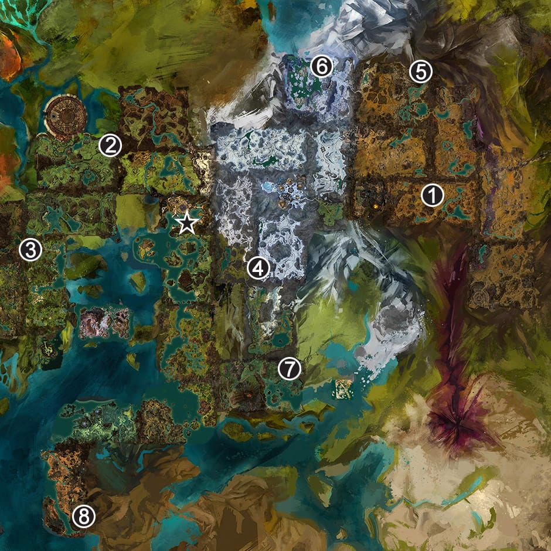
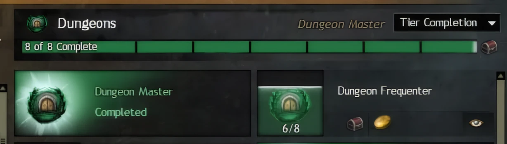

## Fundamentos

Antes de montar seu grupo, descubra o que são as Dungeons, o que elas dão e como funcionam os Achievements.

<Card icone="introducao-as-dungeons">

### Introdução às Dungeons

Você e mais 4 jogadores entram juntos numa **Dungeon**: uma instância (área fechada só para o seu grupo) para personagens de nível **30 a 80**. A Party de 5 avança resolvendo quebra-cabeças e derrotando bosses. Como as Dungeons fazem parte do jogo base (Core), você não precisa de nenhuma expansão para jogar.

Cada Dungeon tem dois modos:

<Item icone="book-open">**Story**: abre sozinho quando você chega ao nível da Dungeon. Conta a história do seu personagem, e você precisa concluí-lo para liberar o modo Explorable.</Item>

<Item icone="swords">**Explorable**: abre depois que você conclui a Story da mesma Dungeon. Tem vários paths (caminhos) e recompensas melhores, então é nele que você joga depois da Story.</Item>

Para entrar, vá até a entrada da Dungeon, que fica em um dos mapas do jogo Core. O mapa abaixo mostra onde está cada uma.

{/* PENDENTE (auditoria de direitos, 18/11/2026): imagem de origem desconhecida; o usuário vai gerar uma substituta. Ver design-system/auditoria-direitos.md */}

<Aviso tipo="atencao" titulo="Requisitos de acesso">Você libera o modo Story quando seu personagem chega ao nível da dungeon (o número depois de "Story" no cabeçalho de cada uma). Para o Explorable, você precisa desse nível e da Story da mesma dungeon concluída com o mesmo personagem. Só quem abre a instância precisa cumprir esses requisitos. Arah não tem modo Story: no lugar dele está o último capítulo da Personal Story, *Victory or Death*.</Aviso>

</Card>

<Card icone="dungeons-recompensas">

### Recompensas

Toda vez que você completa um path, ganha gold, a moeda das próprias Dungeons, materiais e equipamentos. Uma parte dessas recompensas é **diária**.

<Banner imagem="dungeons/artes/gates-of-arah.jpg" alt="Gates of Arah" />

<Item icone="tale-of-dungeon-delving">**Tale of Dungeon Delving**: a principal moeda das Dungeons. Você troca por equipamentos *exotic*, skins exclusivas, runas e sigils. Cada path do Explorable dá **20**, mais um bônus de **80 como recompensa diária** por path. O NPC de troca fica no **Fort Marriner**, em Lion's Arch ([wiki](https://wiki.guildwars2.com/wiki/Fort_Marriner)).</Item>

<Item icone="empyreal-fragment">**Empyreal Fragment**: você usa para fabricar equipamentos **Ascended** e enhancements. Você ganha **20 nos dois primeiros paths** de cada dungeon, uma vez por dia.</Item>

<Item icone="coins">**Gold**: cada path do Explorable dá **26 silvers**. A recompensa diária dá mais um valor entre **35 silvers e 1 gold e 5 silvers**, conforme a dungeon e o path.</Item>

<Item icone="trending-up">**Experiência**: cada path do Explorable dá experiência equivalente a **70% de um nível** do personagem. Se você está subindo de nível (leveling), é uma boa opção.</Item>

</Card>

<Card icone="map-pin" semSumario>

### Dungeon Merchants e outras fontes de Tales

Você pode trocar seus Tales of Dungeon Delving em qualquer **Dungeon Merchant**. As recompensas diárias das dungeons renovam às **00:00 UTC**, que para nós, no horário de Brasília, é 21:00.

<Item icone="map-pin">**Camp Resolve**: no mapa The Silverwastes há outro Dungeon Merchant. Para liberá-lo, conclua o serviço *Donate bandit crests to requisition additional camp services* e escolha o Dungeon Merchant.</Item>

<Item icone="lock">**Requisito de compra**: você só pode comprar os itens de uma dungeon depois de completá-la pelo menos uma vez. Se sua conta já tinha completado algum path antes de 07/06/2022, você não precisa cumprir isso.</Item>

<Item icone="refresh-cw">**Tyrian Dungeon Explorer Track**: reward track (trilha de recompensas) de PvP e WvW que você pode repetir. Ao completá-la, você ganha 240 Tales, 3 armas e 1 peça de armadura de dungeon.</Item>

<Item icone="trophy">**Dungeon Rush**: evento temporário que volta de tempos em tempos (última edição: 15 a 22/07/2026). Os achievements do evento dão 770 Tales no total, e concluir um modo Story conta como path.</Item>

</Card>

<Card icone="achievements">

### Achievements

Abra a janela de Achievements do jogo: as Dungeons têm uma aba própria. Cada achievement que você conclui rende **títulos**, **Tales of Dungeon Delving** e gold.

<Item icone="trophy">**Dungeon Master**: você ganha ao completar todas as Dungeons do jogo, ou seja, todos os modos Story e todos os Explorables. A conta recebe o título **"Dungeon Master"**.</Item>

<Item icone="repeat">**Dungeon Frequenter**: você pode ganhar mais de uma vez, de novo a cada **8 paths diferentes** completados (Story ou Explorable). Dá **5 de gold** e **150 Tales of Dungeon Delving**.</Item>

<Item icone="palette">**Dungeoneer**: fica na aba *"Rare Collections"*. Você conclui ao liberar todas as skins de armas e armaduras de todas as Dungeons (comprando no NPC ou pelas Reward Tracks de PvP e WvW). Dá o título **"Dungeoneer"**.</Item>

<Item icone="trees">**Twilight Arbor Aetherpath**: categoria separada, só para o Aetherpath, um desafio **level 80** dentro da Dungeon Twilight Arbor.</Item>

</Card>

## As 8 Dungeons

Estas são as Dungeons clássicas de Tyria. Cada uma traz nível, inimigos, localização e o vídeo de cada path.

<Dungeon nome="ASCALONIAN CATACOMBS" niveis="Story 30, Explo 35" arte="dungeons/artes/ascalonian-catacombs.jpg" alt="Ascalonian Catacombs" sumario="Ascalonian Catacombs">
<Info>**Inimigos:** Ghosts</Info>
<Info>**Local:** Plains of Ashford</Info>
<Info>**Waypoint:** [Ascalonian Catacombs Waypoint](https://wiki.guildwars2.com/wiki/Phasmatis_Corridor#Ascalonian_Catacombs_Waypoint)</Info>
<Path nome="Story" video="https://www.youtube.com/watch?v=o-853dj6hUg"/>
<Path nome="Path 1" video="https://www.youtube.com/watch?v=YUi-jNv0E9E"/>
<Path nome="Path 2" video="https://www.youtube.com/watch?v=FI3Aw8XNN7s"/>
<Path nome="Path 3" video="https://www.youtube.com/watch?v=WMhBseWHUJg"/>
</Dungeon>

<Dungeon nome="CAUDECUS'S MANOR" niveis="Story 40, Explo 45" arte="dungeons/artes/caudecus-s-manor.jpg" alt="Caudecus's Manor" sumario="Caudecus's Manor">
<Info>**Inimigos:** Bandits</Info>
<Info>**Local:** Queensdale</Info>
<Info>**Waypoint:** [Beetletun Waypoint](https://wiki.guildwars2.com/wiki/Shire_of_Beetletun#Beetletun_Waypoint)</Info>
<Path nome="Story" video="https://www.youtube.com/watch?v=uOGD6ZLvFI8"/>
<Path nome="Path 1" video="https://www.youtube.com/watch?v=yv2iFCRNp4o"/>
<Path nome="Path 2" video="https://www.youtube.com/watch?v=8ytsneIuAAQ"/>
<Path nome="Path 3" video="https://www.youtube.com/watch?v=ByDSoege70Y"/>
</Dungeon>

<Dungeon nome="TWILIGHT ARBOR" niveis="Story 50, Explo 55, Aetherpath 80" arte="dungeons/artes/twilight-arbor.jpg" alt="Twilight Arbor" sumario="Twilight Arbor">
<Info>**Inimigos:** Nightmare Court e Aetherblades</Info>
<Info>**Local:** Caledon Forest</Info>
<Info>**Waypoint:** [Twilight Arbor Waypoint](https://wiki.guildwars2.com/wiki/Wychmire_Swamp#Twilight_Arbor_Waypoint)</Info>
<Path nome="Story" video="https://www.youtube.com/watch?v=zUojVR0Y2GM"/>
<Path nome="Path 1" video="https://www.youtube.com/watch?v=Ret-dxQlfiE"/>
<Path nome="Path 2" video="https://www.youtube.com/watch?v=b42ejXg4Xec"/>
<Path nome="Aetherpath" video="https://www.youtube.com/watch?v=cqUvn_ybu3E"/>
</Dungeon>

<Dungeon nome="SORROW'S EMBRACE" niveis="Story 60, Explo 65" arte="dungeons/artes/sorrow-s-embrace.jpg" alt="Sorrow's Embrace" sumario="Sorrow's Embrace">
<Info>**Inimigos:** Dredge e Inquest</Info>
<Info>**Local:** Dredgehaunt Cliffs</Info>
<Info>**Waypoint:** [Tribulation Waypoint](https://wiki.guildwars2.com/wiki/Tribulation_Rift#Tribulation_Waypoint)</Info>
<Path nome="Story" video="https://www.youtube.com/watch?v=PwWA7eQzxdg"/>
<Path nome="Path 1" video="https://www.youtube.com/watch?v=0qPUzhj2t4k"/>
<Path nome="Path 2" video="https://www.youtube.com/watch?v=9TRvLPmXjZY"/>
<Path nome="Path 3" video="https://www.youtube.com/watch?v=0xtJtr5AuIs"/>
</Dungeon>

<Dungeon nome="CITADEL OF FLAME" niveis="Story 70, Explo 75" arte="dungeons/artes/citadel-of-flame.jpg" alt="Citadel of Flame" sumario="Citadel of Flame">
<Info>**Inimigos:** Flame Legion e Elementals</Info>
<Info>**Local:** Fireheart Rise</Info>
<Info>**Waypoint:** [The Citadel of Flame Waypoint](https://wiki.guildwars2.com/wiki/The_Baelfire#The_Citadel_of_Flame_Waypoint)</Info>
<Path nome="Story" video="https://www.youtube.com/watch?v=GMAoprwjHf0"/>
<Path nome="Path 1" video="https://www.youtube.com/watch?v=9DiJ6Dsu-AM"/>
<Path nome="Path 2" video="https://www.youtube.com/watch?v=t_wImoF0brA"/>
<Path nome="Path 3" video="https://www.youtube.com/watch?v=PIDXZxBejzI"/>
</Dungeon>

<Dungeon nome="HONOR OF THE WAVES" niveis="Story 76, Explo 80" arte="dungeons/artes/honor-of-the-waves.jpg" alt="Honor of the Waves" sumario="Honor of the Waves">
<Info>**Inimigos:** Icebrood e Sons of Svanir</Info>
<Info>**Local:** Frostgorge Sound</Info>
<Info>**Waypoint:** [Honor of the Waves Waypoint](https://wiki.guildwars2.com/wiki/Watchful_Fjord#Honor_of_the_Waves_Waypoint)</Info>
<Path nome="Story" video="https://www.youtube.com/watch?v=g1UWtcc5qTg"/>
<Path nome="Path 1" video="https://www.youtube.com/watch?v=33fM7PdZAAQ"/>
<Path nome="Path 2" video="https://www.youtube.com/watch?v=22YO5wlmUb8"/>
<Path nome="Path 3" video="https://www.youtube.com/watch?v=qKJtPUZoSKI"/>
</Dungeon>

<Dungeon nome="CRUCIBLE OF ETERNITY" niveis="Story 78, Explo 80" arte="dungeons/artes/crucible-of-eternity.jpg" alt="Crucible of Eternity" sumario="Crucible of Eternity">
<Info>**Inimigos:** Destroyers, Icebrood, Inquest, Risen e Outlaw</Info>
<Info>**Local:** Mount Maelstrom</Info>
<Info>**Waypoint:** [Crucible of Eternity Waypoint](https://wiki.guildwars2.com/wiki/Infinite_Coil_Reactor#Crucible_of_Eternity_Waypoint)</Info>
<Path nome="Story" video="https://www.youtube.com/watch?v=-4aXb8_pIR8"/>
<Path nome="Path 1" video="https://www.youtube.com/watch?v=vXbXmoANLhw"/>
<Path nome="Path 2" video="https://www.youtube.com/watch?v=BzqAYFPvjxA"/>
<Path nome="Path 3" video="https://www.youtube.com/watch?v=zibs_5QFCjI"/>
</Dungeon>

<Dungeon nome="THE RUINED CITY OF ARAH" niveis="Explo 80" arte="dungeons/artes/the-ruined-city-of-arah.jpg" alt="The Ruined City of Arah" sumario="The Ruined City of Arah">
<Info>**Inimigos:** Risen</Info>
<Info>**Local:** Cursed Shore</Info>
<Info>**Waypoint:** [Arah Waypoint](https://wiki.guildwars2.com/wiki/The_Narthex#Arah_Waypoint)</Info>
<Info>**Paths:** 1 Jotun, 2 Mursaat, 3 Forgotten, 4 Seer (o mais longo, com 7 bosses)</Info>
<Path nome="Path 1" video="https://www.youtube.com/watch?v=5zhRefJn0ig"/>
<Path nome="Path 2" video="https://www.youtube.com/watch?v=qh05XMEdBUI"/>
<Path nome="Path 3" video="https://www.youtube.com/watch?v=j9XozKQzii0"/>
<Path nome="Path 4" video="https://www.youtube.com/watch?v=2uXao7Xgl30" wiki="https://wiki.guildwars2.com/wiki/The_Ruined_City_of_Arah_(explorable)"/>
</Dungeon>
