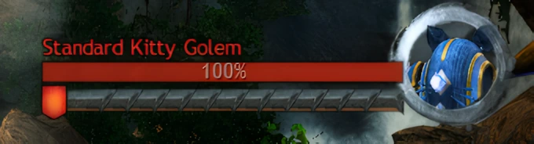
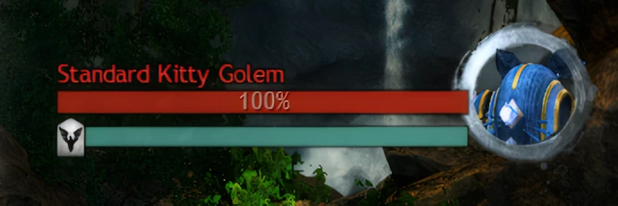
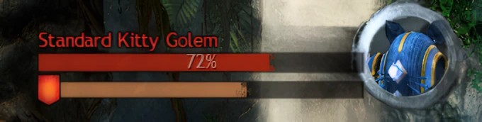
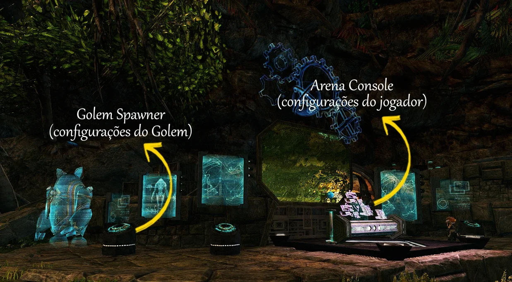
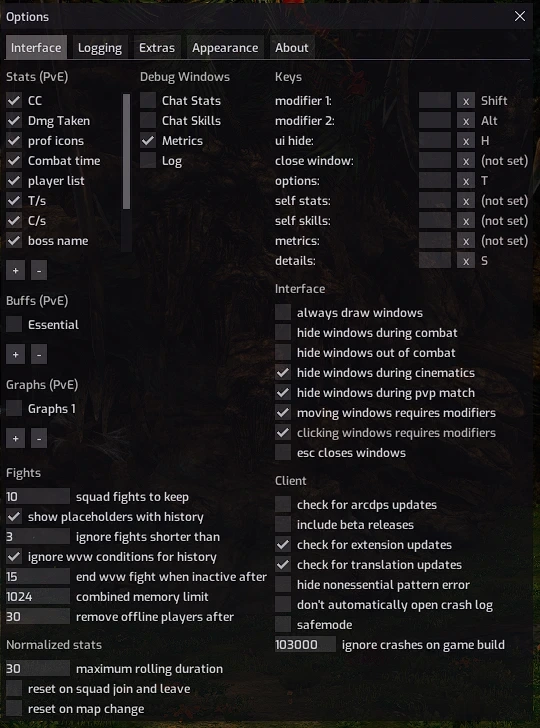
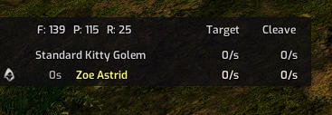
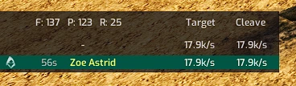
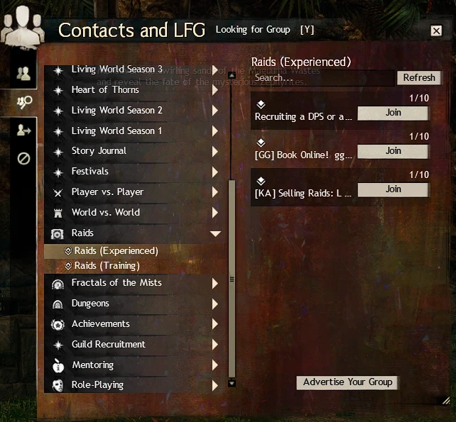

## Fundamentos

Aprenda o vocabulário e as regras de combate que todo squad usa, para acompanhar qualquer explicação de boss.

<Card icone="swords">

### Introdução

Antes do primeiro squad, vale entender como o conteúdo em grupo funciona. Aqui você aprende o básico que serve para Dungeons, Raids e Fractals: sua **build** (o conjunto de equipamento, traits e skills do personagem), sua função no grupo e como ela se encaixa no trabalho em equipe.

O guia começa no **aprendizado individual** e termina na **prática em grupo**. Siga as etapas na ordem, porque cada uma prepara a próxima.

<Banner imagem="endgame/endgame-introducao.webp" alt="Ilustração de um squad enfrentando a esfera do Nexus of Eternity numa arena de pedra" />

</Card>

<Card icone="zap">

### Tipos de dano

Toda build causa dano de um destes três jeitos, e saber qual é o da sua ajuda a escolher e jogar a build certa.

<Item icone="zap">**Strike Damage**: também chamado de dano bruto ou dano "Power", porque aumenta com esse atributo. É **instantâneo** e pode ser um acerto crítico (a chance sobe com Critical Chance). A Armor do alvo (Toughness + Defense) reduz esse dano.</Item>

<Item icone="biohazard">**Condition Damage**: dano causado pelas conditions <Efeito nome="burning" soIcone semBalao /> <Efeito nome="bleeding" soIcone semBalao /> <Efeito nome="poisoned" soIcone semBalao /> <Efeito nome="confusion" soIcone semBalao /> <Efeito nome="torment" soIcone semBalao /> aplicadas no alvo, que tiram a vida dele aos poucos. Aumenta diretamente com **Condition Damage** e indiretamente com **Condition Duration** (a duração das conditions).</Item>

<Item icone="droplet">**Lifesteal Damage**: dano que **tira vida** de um alvo e a devolve para você como cura. Várias skills e buffs causam esse dano.</Item>

</Card>

<Card icone="sparkles" sumario="Boons e Boon Corrupt">

### Boons

No squad, os **boons** fazem a diferença: efeitos positivos que ficam em um jogador e ajudam muito em combate. Para o melhor desempenho, Quickness, Alacrity, Might, Fury e Protection precisam estar ativos em todo o squad o tempo todo (**100% de uptime**).

Os outros boons você usa só de vez em quando: para evitar dano e mecânicas, para algumas classes funcionarem bem ou para uma luta específica. A maioria dura no máximo 30 segundos, por isso entram só quando a luta pede.

<Item icone="quickness">**Quickness**: suas skills ficam **50%** mais rápidas de usar (na prática, ~33% menos tempo de conjuração).</Item>

<Item icone="alacrity">**Alacrity**: suas skills recarregam **25%** mais rápido (levam 80% do tempo, ou seja, −20%).</Item>

<Item icone="might">**Might**: aumenta Power e Condition Damage. Stack máximo de 25. No level 80, +750 de cada atributo (+30 por stack).</Item>

<Item icone="fury">**Fury**: aumenta Critical Chance em **25%**.</Item>

<Item icone="protection">**Protection**: diminui o dano de Strike Damage recebido em **33%**.</Item>

<Item icone="regeneration">**Regeneration**: cura ao longo do tempo. Efetividade afetada por Healing Power.</Item>

<Item icone="vigor">**Vigor**: aumenta a taxa de regeneração de endurance (barra de dodge).</Item>

<Item icone="resolution">**Resolution**: diminui o dano de Condition Damage recebido em **33%**.</Item>

<Item icone="stability">**Stability**: protege contra controles de grupo, o CC (Stun, Daze, Float, Fear, Taunt, Knock Down etc.). Acumula até 25 stacks, e cada CC recebido consome stacks.</Item>

<Item icone="aegis">**Aegis**: bloqueia o próximo ataque recebido.</Item>

<Item icone="resistance">**Resistance**: neutraliza os efeitos das conditions **Blinded, Chilled, Crippled, Fear, Immobile, Slow, Taunt, Weakness e Vulnerability**.</Item>

<Item icone="swiftness">**Swiftness**: aumenta a velocidade de movimento em **33%**.</Item>

</Card>

<Card icone="tornado" semSumario>

### Boon Corrupt

Algumas skills, traits e sigils do seu personagem transformam os boons de um alvo em conditions, e cada boon vira uma condition específica:

<Mapa legenda="Boon Corrupt" legendaOculta de="Boon" para="Condition" pares={[['aegis', 'burning'], ['alacrity', 'chilled'], ['fury', 'blinded'], ['might', 'weakness'], ['protection', 'vulnerability'], ['quickness', 'slow'], ['regeneration', 'poisoned'], ['resistance', 'chilled'], ['resolution', 'confusion'], ['stability', 'fear'], ['swiftness', 'crippled'], ['vigor', 'bleeding']]} />

</Card>

## Conceitos avançados

Entenda como conditions, buffs e a Defiance Bar funcionam, para saber o que fazer quando o boss pedir.

<Card icone="skull" sumario="Conditions (dano e CC)">

### Conditions

Toda vez que você faz o boss queimar, sangrar ou ficar envenenado, está aplicando **conditions**: efeitos negativos que causam dano ou atrapalham o alvo. As de dano acumulam em intensidade, até 1500x. As de controle acumulam em duração, até 10 segundos. A **Vulnerability** para em 25 stacks.

Bosses e jogadores aplicam conditions. Se você joga de Condition DPS, elas são o seu foco, e por isso a role prioriza Condition Damage e Condition Duration.

#### Conditions de dano

<Item icone="bleeding">**Bleeding** e **<Efeito nome="burning" />**: ambas causam dano ao longo do tempo. O cálculo do dano é diferente, e o valor final do Burning é maior.</Item>

<Item icone="poisoned">**Poison**: dano ao longo do tempo e redução de **33%** da cura recebida.</Item>

<Item icone="confusion">**Confusion**: dano ao longo do tempo e dano adicional quando o alvo ativa uma skill.</Item>

<Item icone="torment">**Torment**: dano ao longo do tempo e dano adicional se o alvo **não está se movendo**.</Item>

#### Conditions de controle de grupo

<Obs>Fazem CC enquanto estão ativas, ou seja, **causam dano à Defiance Bar** (a barra de CC do alvo, explicada mais abaixo).</Obs>

<Item icone="blinded">**Blind**: anula o próximo ataque.</Item>

<Item icone="chilled">**Chill**: diminui a velocidade de movimento em **66%** e aumenta o tempo de recarga de skills em **~40%**.</Item>

<Item icone="crippled">**Cripple**: diminui a velocidade de movimento em **50%**.</Item>

<Item icone="fear">**Fear**: interrompe o alvo e o faz correr para longe. Uma Stun Break (skill que tira você de CC) remove o efeito.</Item>

<Item icone="immobile">**Immobile**: impede o alvo de se mover, virar ou esquivar. O alvo ainda pode atacar. Teleportes ainda funcionam.</Item>

<Item icone="slow">**Slow**: aumenta o tempo de animação de qualquer ação do alvo (skills, esquiva, movimentação).</Item>

<Item icone="taunt">**Taunt**: força o alvo a ir até quem aplicou o efeito e atacá-lo. Todas as skills ficam desabilitadas, menos as Stun Breaks.</Item>

<Item icone="weakness">**Weakness**: diminui em **50%** a recuperação da barra de dodge e faz **50%** dos acertos do alvo virarem *Glancing Blows* (metade do dano, sem crítico).</Item>

<Item icone="vulnerability">**Vulnerability**: aumenta o Strike e Condition Damage que o alvo recebe em **1% por stack** (total 25%). Não é condition de dano e não reduz Break Bars.</Item>

</Card>

<Card icone="apple" sumario="Buffs (Food, Utility e outros)">

### Buffs

Antes de entrar na luta, confira seus **buffs**: são todos os efeitos positivos que afetam os jogadores, como boons, auras e boosts. Em conteúdo em grupo os buffs de combate são obrigatórios, porque mudam bastante o desempenho.

<Item icone="apple">**Nourishment (Foods)**: consumíveis que dão atributos extras e outros benefícios. Em grupo, as mais comuns são as foods **Ascended**, feitas por Chef.  <small>[Glossário das foods mais utilizadas →](https://snowcrows.com/guides/getting-started/guild-wars-2-food-glossary)</small></Item>

<Item icone="wrench">**Enhancement (Utilities)**: consumíveis que aumentam um atributo específico. Vão dos simples (Sharpening Stones, Tuning Crystals) até os **Writs**, versões superiores que dão um ganho grande de DPS. São feitos por Weaponsmith, Huntsman, Artificier e Scribe (os Writs).</Item>

#### Outros buffs

<Item icone="wind">**Superspeed**: +100% de velocidade de movimento em combate e +33% fora de combate.</Item>

<Item icone="shield">**Reinforced Armor**: +5% de Vitality e Defense. Você ganha usando as bigornas espalhadas pelo mundo.</Item>

<Item icone="sparkles">**Invulnerability**: imunidade a dano e conditions.</Item>

<Item icone="eye-off">**Stealth**: invisibilidade. Algumas estratégias de conteúdo em grupo usam esse efeito.</Item>

</Card>

<Card icone="gauge" sumario="Defiance Bar">

### Defiance Bar (barra de CC)

Quando alguém no squad pede CC, é a **Defiance Bar** que precisa cair. Ela aparece em vários pontos do jogo, principalmente em bosses: enquanto está ativa, todo CC que você usa só desconta da barra, sem o efeito normal. Quebre a barra e o alvo fica desabilitado ou vulnerável, e é por isso que o squad junta os CCs na hora certa.

Para reduzir a barra, você usa **Soft CCs** (as conditions de controle listadas acima) ou **Hard CCs** instantâneos: Knockdown, Daze, Stun, Launch, Knockback, Pull, Float, Transform, Petrify, Freeze e Ward.

Cada tipo de CC tira uma quantidade diferente da barra: o Stun causa entre 100 e 500 de dano instantâneo a ela, e o Fear, 100 de dano por segundo.

#### Estados da Defiance Bar

Você vê a barra logo abaixo da vida do alvo. As imagens abaixo são do Golem de treino.

<Item icone="lock">**Travada**: o alvo é imune a qualquer tipo de CC. A barra aparece cinza e dividida em segmentos.</Item>

<Item icone="activity">**Ativa**: os efeitos do CC não pegam no alvo, mas a barra diminui conforme o CC aplicado. A barra aparece azul.</Item>

<Item icone="zap">**Quebrada**: o alvo fica desabilitado e imune a novos danos de CC até a barra se regenerar. A barra aparece laranja e vai enchendo de novo.</Item>

</Card>

## Seleção e montagem de builds

Monte uma build que faz o que o squad espera de você, sem precisar inventar do zero.

<Card icone="chart-column" sumario="Atributos (primários, secundários, derivados)">

### Atributos

Para a build cumprir a sua função, você precisa dos **atributos** certos. No equipamento, eles vêm em combinações com nome de prefixo, como Berserker's, Viper's e Minstrel, entre outros.

Você aumenta os atributos com o equipamento (armadura, armas e acessórios), com buffs consumíveis e boons, e com skills e traits.

#### Atributos primários

<Obs>Aumentam com base no nível do personagem.</Obs>

<Item icone="power">**Power**: aumenta o Strike Damage que você causa.</Item>

<Item icone="toughness">**Toughness**: reduz o Strike Damage que você recebe. Também define quem o boss ataca em alguns encontros (role **Tank**).</Item>

<Item icone="vitality">**Vitality**: cada ponto aumenta a vida máxima em 10.</Item>

<Item icone="precision">**Precision**: entra no cálculo da chance de acerto crítico.</Item>

#### Atributos secundários

<Obs>Não aumentam com base no nível.</Obs>

<Item icone="ferocity">**Ferocity**: aumenta o dano dos acertos críticos.</Item>

<Item icone="condition-damage">**Condition Damage**: aumenta o dano das conditions que você aplica.</Item>

<Item icone="expertise">**Expertise**: aumenta em 1% a duração das conditions que você aplica a cada 15 pontos.</Item>

<Item icone="concentration">**Concentration**: aumenta em 1% a duração dos boons que você aplica a cada 15 pontos.</Item>

<Item icone="healing-power">**Healing Power**: aumenta a cura que você aplica nos alvos.</Item>

#### Atributos derivados

<Obs>Calculados a partir dos atributos primários e secundários, além de fatores externos (classe, equipamento).</Obs>

<Item icone="armor">**Armor**: reduz o Strike Damage recebido. É a soma de Toughness + Defense.</Item>

<Item icone="health">**Health**: quanto dano você aguenta antes de cair. Aumenta com Vitality.</Item>

<Item icone="critical-chance">**Critical Chance**: chance de causar acertos críticos (5–100%). Aumenta com Precision e com o boon Fury.</Item>

<Item icone="critical-damage">**Critical Damage**: dano dos acertos críticos. Aumenta com Ferocity.</Item>

<Item icone="condition-duration">**Condition Duration**: duração das conditions que você aplica. Aumenta com Expertise.</Item>

<Item icone="boon-duration">**Boon Duration**: duração dos boons que você aplica. Aumenta com Concentration.</Item>

</Card>

<Card icone="drama" sumario="Roles primárias e secundárias">

### Roles

Cada pessoa do squad assume uma **role**, a função que ela cumpre na luta. Cada role usa uma ou mais combinações de atributos de equipamento, runas, sigils e traits, e você precisa delas para cumprir a função bem.

#### Roles primárias

<Item icone="swords">**DPS**: causa o máximo de dano por segundo. Tem duas variações: **Power DPS** (Strike Damage) e **Condition DPS** (Condition Damage). Vale ter as duas, porque cada cenário favorece um tipo.</Item>

<Item icone="sword">**Support DPS**: causa dano e também fornece **<Efeito nome="quickness" />** ou **<Efeito nome="alacrity" />**. Trabalha em dupla com o Healer: um dá Quickness e o outro, Alacrity. Precisa manter os boons 100% do tempo **enquanto** causa o máximo de dano.</Item>

<Item icone="heart">**Healer**: o foco é dar boons ao grupo: <Efeito nome="might" soIcone semBalao /> <Efeito nome="protection" soIcone semBalao /> <Efeito nome="fury" soIcone semBalao /> e <Efeito nome="quickness" soIcone semBalao /> ou <Efeito nome="alacrity" soIcone semBalao />. Boons como <Efeito nome="stability" soIcone semBalao /> <Efeito nome="aegis" soIcone semBalao /> <Efeito nome="resistance" soIcone semBalao /> neutralizam mecânicas. O foco secundário é curar e/ou dar barreira.</Item>

<Item icone="heart-pulse">**Hybrid Healer**: joga como Healer, mas com atributos e traits diferentes, que somam dano sem perder os boons nem a cura/barreira.</Item>

#### Roles secundárias

<Obs>Alguns conteúdos pedem essas roles. Quem cuida delas é alguém das roles primárias (DPS, Support DPS ou Healer).</Obs>

<Item icone="shield">**Tank**: posiciona o boss e recebe os ataques dele. Em geral é o Healer, mas qualquer role pode fazer. O boss escolhe o alvo pela Toughness de cada jogador, por quem está mais perto ou por quem ele enxerga.</Item>

<Item icone="wind">**Kiter**: cuida de mecânicas específicas, normalmente longe do grupo. Precisa ficar sozinho. Pode ser um DPS ou um Healer.</Item>

</Card>

<Card icone="globe" sumario="SnowCrows, benchmarks e equipamentos">

### Onde encontrar builds prontas

Enquanto você não domina a teoria por trás das builds, use uma build pronta em vez de montar do zero. O site de referência é o Snow Crows:

<Item icone="bird">**[Snow Crows](https://snowcrows.com)**: cobre Raids, Raid Encounters e Fractals. Tem builds para todos esses conteúdos, e é o site que usamos neste guia.</Item>

#### Benchmarks

Na aba de [Benchmarks](https://snowcrows.com/benchmarks) do SnowCrows, você compara o dano de cada build. Mas **a build com mais dano nem sempre é a mais recomendada**: uma boa build equilibra dano, aplicação de boons e conditions, e utilidade.

#### Prós e contras

Na página de cada build, a aba de prós e contras mostra esse equilíbrio. Se a build tem muitos contras, ela **não é necessariamente ruim**: depende do cenário e de com qual você se sente mais confortável.

#### Equipamentos e buffs

Escolheu a build? Agora monte o equipamento. Alguns pontos:

<Item icone="shield">**Set Ascended vs Exotic**: você só precisa de Ascended em **Fractals de tier alto**. Para Raids e Raid Encounters, um **set Exotic** funciona. A diferença entre os dois é de **5%**.</Item>

<Item icone="apple">**Foods**: as do site são Ascended, mas você pode usar a versão **Exotic**. A tabela de substituição está no [Glossário](https://snowcrows.com/guides/getting-started/guild-wars-2-food-glossary).</Item>

<Item icone="gem">**Infusions**: só valem a pena para o **máximo desempenho**, com ganho de **2.5%** no dano total.</Item>

<Item icone="bot">**Jade Bot Core**: dá Vitality e aparece em todas as builds. Algumas builds aproveitam essa Vitality extra para render mais.</Item>

</Card>

<Card icone="network" sumario="Traits, skills e rotação">

### Traits e skills

Sua build não é só equipamento: ela depende também das traits e das skills.

**Traits**: você as escolhe no Hero Panel. Cada uma muda algo específico (uma skill, um atributo, o ganho de boons, um bônus de dano etc.). As traits também definem a especialização de elite. **Leia todas as traits** para entender como a build funciona.

**Skills**: ocupam os slots utilitários. Dependem da classe, da raça e da especialização de elite (não da arma). Aprenda lendo as descrições e praticando.

Traits e skills **não são totalmente fixas**: você pode trocá-las conforme o cenário.

</Card>

<Card icone="refresh-cw" semSumario>

### Rotação

Com a build pronta, aprenda a **rotação**: a sequência de ações que faz a build render como deveria.

<Item icone="clapperboard">**Opening (Abertura)**: a primeira sequência de ações quando a luta começa, com todas as skills disponíveis. Nos DPS, ela dá um **pico de dano no início**, que cai ao longo da luta.</Item>

<Item icone="repeat">**Loop**: algumas builds têm. É uma sequência de ações que se repete, com início e fim definidos. Algumas classes têm **Burst Loop** (skills usadas dentro de buffs temporários de dano) e **Non-Burst Loop** (skills com dano base).</Item>

<Obs>A Opening dos Healers costuma servir para colocar o máximo de boons no grupo no menor tempo. Depois vêm a manutenção desses boons, a cura e os boons ocasionais.</Obs>

</Card>

## Aplicação e performance

Treine sua build no Golem, meça o resultado com o ArcDPS e afine a rotação antes de entrar no squad.

<Card icone="bot">

### Golem de treino

O último passo do aprendizado individual é testar a build num ambiente isolado. Assim você cria **memória muscular**, ganha velocidade e fixa os conceitos.

O Golem fica na **Special Forces Training Area**, no [Aerodrome Waypoint](https://wiki.guildwars2.com/wiki/Special_Forces_Training_Area), perto do banco.

#### Configurações do jogador (Arena Console)

Na Arena Console, escolha as opções nesta ordem:

<ol class="steps">
<li>**Adjust Self**</li>
<li>**Add Boons**</li>
<li>**All of them**</li>
</ol>

<Obs>Algumas classes ganham benefícios extras com certos boons. Leve isso em conta ao treinar. Você encontra esses detalhes na página e no log da build no SnowCrows.</Obs>

#### Configurações do Golem (Golem Spawner)

No Golem Spawner, escolha as opções nesta ordem:

<ol class="steps">
<li>**Spawn a golem**</li>
<li>**Average**</li>
<li>**Average enemy (4,000,000 health)**</li>
<li>**Additional Options**</li>
<li>**Add Conditions**</li>
<li>Aplique: <Efeito nome="bleeding" soIcone semBalao /> <Efeito nome="burning" soIcone semBalao /> <Efeito nome="poisoned" soIcone semBalao /> <Efeito nome="confusion" soIcone semBalao /> <Efeito nome="torment" soIcone semBalao /> <Efeito nome="chilled" soIcone semBalao /> <Efeito nome="crippled" soIcone semBalao /> <Efeito nome="slow" soIcone semBalao /> <Efeito nome="weakness" soIcone semBalao /> e **25 stacks de** <Efeito nome="vulnerability" soIcone semBalao /></li>
</ol>

#### Contabilização de dano

Cada vez que o Golem perde **20% da vida**, o chat mostra o DPS daquele trecho. Compare com o benchmark da build e tente chegar a **pelo menos 90%** do valor (ex.: 45713 × 90% = 43427).

<Aviso tipo="atencao">Para o dano ser contado certo, você **não pode entrar em combate** com o Golem antes de começar a rotação. Se entrar, o resultado fica pior. Nesse caso, resete o Golem e use **Respawn my previous golem incarnation** para chamar outro com as mesmas configurações.</Aviso>

#### Outras opções do Golem Spawner

<Item icone="settings">**Hitbox**: Average, Large (2x o Average) ou Huge (5x). O Average é o Standard Kitty Golem, com 2597 de Armor.</Item>

<Item icone="chart-column">**Vida**: Weak enemy (1,000,000), Average enemy (4,000,000), Strong enemy (10,000,000) ou Crazy-strong enemy (40,000,000).</Item>

<Item icone="zap">**Additional Options**: Defiance bar (Weak, Average, Strong ou Extreme) para treinar CC, além de Add movement, Add condition immunity e Add strike damage immunity.</Item>

<Item icone="map-pin">**Outros acessos**: pelo portal ao lado das entradas do Aerodrome, em Lion's Arch; pela Asura gate de Eye of the North, depois de comprar o link com Mechanist Ninn; e por Arborstone, falando com Lyra perto do portal dos Raid Encounters (antigas Strikes), se você já comprou o link de Eye of the North.</Item>

#### Configurações adicionais

As configurações acima servem só para treinar a função de DPS. Para as outras funções:

<Item icone="sword">**Support DPS**: tire o boon que a sua build já aplica (<Efeito nome="quickness" soIcone semBalao /> ou <Efeito nome="alacrity" soIcone semBalao />).</Item>

<Item icone="heart">**Healer**: aplique só o boon que a sua classe **não fornece**. Para ligar o dano na arena, vá na **Arena Console**: Adjust environment → Toggle pulsing arena damage on → escolha a intensidade.</Item>

</Card>

<Card icone="chart-column" sumario="ArcDPS: instalação e configuração">

### ArcDPS

Para medir seu DPS e seus boons fora da Special Forces Training Arena, que é um ambiente isolado, instale o addon **ArcDPS**. Ele tem funções para PvE, WvW e PvP.

#### Download e instalação

Baixe no [site oficial](https://www.deltaconnected.com/arcdps/x64/) (arquivo `d3d11.dll`). Com o jogo fechado, coloque-o na pasta do jogo, ao lado do `Gw2-64.exe` (por padrão `C:\Program Files\Guild Wars 2`). Quando abrir o jogo de novo, a HUD do ArcDPS (os painéis do addon na tela) aparece e você já pode configurá-la.

<Aviso tipo="dica" titulo="Raidcore Nexus">

É um gerenciador de addons, com uma biblioteca dentro do jogo, que instala e atualiza os addons para você. Ele também usa um arquivo `d3d11.dll`. Você pode instalar o ArcDPS por ele ou migrar uma instalação que já tem. A ArenaNet não dá suporte a ferramentas de terceiros. Se o jogo travar (crash), o site do ArcDPS orienta reparar o client e remover extensões e chainloads. As regras da ArenaNet para esse tipo de ferramenta estão aqui: [Policy: Third-Party Programs](https://help.guildwars2.com/hc/en-us/articles/360013625034-Policy-Third-Party-Programs).

</Aviso>

#### Configuração

O atalho padrão para abrir as opções é <kbd>Alt + Shift + T</kbd>. Comece pela seção **Stats (PvE)**, que tem várias janelas configuráveis para funções específicas de combate.

#### Configuração do Zyanore

Se não quiser montar tudo do zero, baixe a configuração do Zyanore. Ela mistura os perfis Areki e Delta do repositório [ArcDPS-Styles](https://github.com/DeltaRaidcore/ArcDPS-Styles), onde também há outros estilos para escolher. O zip (23 KB) traz o `arcdps.ini`, a fonte Exo SemiBold (licença livre SIL OFL) e um `LEIA-ME.txt` com o passo a passo.

<Botao variante="primario" href="/downloads/arcdps-zyanore.zip" icone="download" download>Baixar a configuração do Zyanore (.zip)</Botao>

<Aviso tipo="atencao">Usar o `arcdps.ini` inteiro também troca os seus atalhos do ArcDPS: os modificadores passam a ser <kbd>Shift</kbd> e <kbd>Alt</kbd>, e as opções abrem com <kbd>Alt + Shift + T</kbd>. Se quiser manter os seus, use só o visual (passo 4).</Aviso>

<ol class="steps">
<li>Feche o jogo. O ArcDPS grava o `arcdps.ini` quando o jogo fecha e desfaz o que for trocado com ele aberto.</li>
<li>Na pasta do jogo, abra `addons\arcdps` e faça uma cópia do seu `arcdps.ini`, para poder voltar se não gostar.</li>
<li>Para usar a configuração inteira, copie o `arcdps.ini` e o `arcdps_font.ttf` do zip para a pasta `addons\arcdps`, substituindo os arquivos que já estão lá.</li>
<li>Para usar só o visual, copie o `arcdps_font.ttf` para a pasta `addons\arcdps`. Depois abra os dois `arcdps.ini` (o seu e o do zip) no Bloco de Notas e troque no seu apenas as linhas que começam com `appearance_`. O `LEIA-ME.txt` lista quais são.</li>
<li>Abra o jogo. Se alguma janela ficar fora do lugar na sua tela, arraste-a segurando <kbd>Shift + Alt</kbd>.</li>
</ol>

</Card>

<Card icone="settings" semSumario>

### Configuração do ArcDPS

Ao ativar uma aba nas opções do ArcDPS, uma janela se abre na tela. Clique com o botão direito no cabeçalho dessa janela para ver as opções dela.

#### Ordenação

**per second**: ordena pelo dano por segundo causado.  **vs target**: ordena pelo dano total contra o alvo atual.

#### Aba Stats

**Current fight and normalized stats**: escolhe a informação que a janela mostra: **Damage (DPS)** ou **Defiance Damage (CC)**.

**Stats format**: escolhe como os números aparecem:

<Tabela legenda="Stats format: formato dos números" legendaOculta>

| Formato | Significado |
|---|---|
| **@1** | Dano total em múltiplos alvos |
| **@2** | Dano por segundo em múltiplos alvos |
| **@3** | Porcentagem total de dano em múltiplos alvos |
| **@4** | Dano total no alvo prioritário |
| **@5** | Dano por segundo no alvo prioritário |
| **@6** | Porcentagem total de dano no alvo prioritário |

</Tabela>

Veja a janela de DPS já configurada, no Golem. Fora de combate, com o Golem selecionado, ela mostra o nome dele e os totais em 0/s:

Em combate, o total do alvo e o DPS de cada jogador ficam na mesma coluna, embaixo de Target e de Cleave:

<Obs>Você também pode definir uma tecla para abrir essa janela.</Obs>

#### Boon Table

O ArcDPS tem extensões. A lista completa e o suporte ficam no Discord [Elite Insights](https://discord.gg/T4kSbKJ5Sf). Aqui o foco é a extensão [Boon Table](https://github.com/knoxfighter/GW2-ArcDPS-Boon-Table/releases/latest), que mostra quanto de cada boon o grupo e cada jogador receberam.

Depois de baixar, coloque o arquivo em `\Guild Wars 2\bin64`. A extensão aparece na aba **Extensions** do ArcDPS. Para configurá-la, clique com o botão direito no cabeçalho da janela.

#### Logging

Com os **logs** você revê a luta depois: são arquivos com informações detalhadas, como dano e rotação de cada jogador, distribuição de boons, replay etc. Para gravá-los, ative a opção em **Logging**. Os arquivos ficam em `\Documentos\Guild Wars 2\addons\arcdps\arcdps.cbtlogs`, no formato **.evtc** (ou **.zevtc**, se a compressão estiver ativada nas opções).

Para analisar um log, envie o arquivo para o [dps.report](https://dps.report/). O [SnowCrows](https://snowcrows.com/guides/arcdps/reading-logs) tem um tutorial detalhado sobre como ler logs. O [Wingman](https://gw2wingman.nevermindcreations.de/uploader) faz o upload automático e compara seus logs.
</Card>

<Card icone="target" semSumario>

### Aperfeiçoando a rotação

Além da ordem das skills e da função de cada uma, outros fatores pesam bastante, principalmente se você joga com ping alto. Algumas builds usam Loop. Outras têm só um **conceito teórico** de prioridade de skills, sem repetição fixa.

#### Skill Queueing

A maioria das skills funciona em **fila**: enquanto você usa uma skill, já pode apertar a próxima e colocá-la na fila. Quando a primeira termina, a segunda começa na hora. Isso poupa tempo e evita autoattacks no meio.

A fila **não é infinita**: funciona em pares (skill A ativa, skill B na fila, e a skill C só entra quando B começa). Dominar esse mecanismo mantém o DPS alto e reduz o efeito do ping.

<Aviso tipo="atencao">A fila **não vale para tudo**: algumas skills e ações têm prioridade maior e interrompem a fila. Se há uma fila ativa, a última skill dela precisa terminar antes de você usar uma skill de maior prioridade.</Aviso>

#### Skill Priority

Em toda build há **skills de maior prioridade**: use-as o mais rápido possível quando estiverem disponíveis, porque são elas que geram a maior parte do desempenho. Enquanto elas recarregam, use as de menor prioridade (**fillers**).

Entender a prioridade vale mais do que decorar a ordem. Com ela você **se adapta a cenários diferentes** e ganha muito desempenho. Os detalhes de cada build estão na página dela no SnowCrows.

#### Combos

Quando você usa um **finisher** (finalizador) dentro de um **field** (campo), forma um combo. Cada combinação gera um efeito diferente (boons, conditions, auras). A descrição das skills indica se elas são field ou finisher, mas nem todas indicam.

<Item icone="circle-dashed">**Combo fields**: áreas de efeito criadas por skills ou traits. Cada tipo de field aparece como um círculo com estilo diferente.</Item>

<Item icone="target">**Combo finishers**: skills que você usa dentro de um field para fechar o combo e gerar um efeito específico.</Item>

</Card>

## Entrando em um grupo

Ache um grupo, mostre sua experiência e saiba onde ficar quando o squad estiver em ação.

<Card icone="users" semSumario>

### Primeiros passos

Depois de aprender a parte individual, é hora de jogar em grupo. Comece aprendendo a **encontrar um grupo**, dentro e fora do jogo.

#### Antes da primeira raid

<Item icone="settings">**Build**: escolha uma build pronta no SnowCrows e monte o equipamento. Para Raids, um set Exotic funciona.</Item>

<Item icone="sparkles">**Buffs**: leve a Food e a Utility indicadas na build.</Item>

<Item icone="target">**Golem**: treine a rotação até chegar a pelo menos 90% do benchmark.</Item>

<Item icone="chart-column">**ArcDPS**: instale e configure para acompanhar DPS e boons.</Item>

<Item icone="users">**Grupo**: entre só com a role que o LF (a lista de funções que o grupo procura) pede, fique no seu subgrupo e o mais perto possível do squad.</Item>

</Card>

<Card icone="messages-square">

### Servidores do Discord

Para achar grupos temporários ou fixos, o jeito mais fácil é entrar nos servidores do Discord, onde está a maior parte da comunidade do servidor norte-americano. Cada servidor tem foco e regras próprios.

<Item>**[Raid Academy](https://discord.gg/gw2ra)**: Treinamentos de Raid e clears semanais com grupos experientes.</Item>

<Item>**[Skein Gang](https://discord.gg/skeingang)**: Progressão semanal de Raids e Raid Encounters. Nível intermediário.</Item>

<Item>**[SnowCrows](https://discord.gg/qTs63YH)**: Servidor oficial. Recrutamento para grupos de nível intermediário e experiente.</Item>

<Item>**[Void Lounge](https://discord.gg/voidlounge)**: Conteúdos high-end: principalmente CMs de Raids e Raid Encounters.</Item>

<Item>**[Mistlocked \[FotM\]](https://discord.gg/zxeVeSqpuS)**: comunidade de Fractals CM, boa para achar grupo.</Item>

</Card>

<Card icone="search" sumario="LFG, KP e estrutura de squad">

### Looking For Group (LFG)

Aperte <kbd>Y</kbd> para abrir o LFG, o sistema do próprio jogo para achar grupo. Ele tem uma aba para cada tipo de conteúdo. Aqui o foco é em **Raids** (incluindo as antigas **Strike Missions**) e **Fractals of the Mists**. <small>Desde 03/02/2026 as Strike Missions foram renomeadas para **Raid Encounters** e integradas às Raids; a comunidade ainda usa "Strikes" no dia a dia.</small>

A aba de Raids, que agora inclui os Raid Encounters (os antigos Strikes), se divide em **Raids (Experienced)** e **Raids (Training)**. A aba Experienced tem pré-definições que filtram os jogadores por nível de experiência. O Master Tier da aba Fractals funciona do mesmo jeito.

#### Conteúdo do grupo

A descrição do grupo diz o que ele vai fazer. Exemplos:

<Item icone="sword">**W7 FC**: clear completo da Raid Wing 7.</Item>

<Item icone="snowflake">**IBS 5**: os cinco Raid Encounters mais rápidos da Icebrood Saga.</Item>

<Item icone="orbit">**T4 + Recs**: Fractals Tier 4 e recomendadas do dia.</Item>

A maioria dos grupos traz um **LF (Looking For)** na descrição, que diz quais funções ainda faltam. Se você entrar com uma função que não está no LF, pode ser expulso.

</Card>

<Card icone="medal" semSumario>

### Kill Proof (KP)

Grupos que aceitam só jogadores experientes costumam exigir KP, a prova de que você já completou aquele conteúdo uma ou mais vezes.

#### Raids

O KP pode ser os troféus que você ganha ao derrotar cada boss, como [Dhuum's Token](https://wiki.guildwars2.com/wiki/Dhuum%27s_Token) e [Qadim's Token](https://wiki.guildwars2.com/wiki/Qadim%27s_Token). Outra opção é se registrar no [KillProof](https://killproof.me/): ele salva seus KP automaticamente, e você mostra o seu código de acesso como comprovação.

#### Raid Encounters CM e Fractals CM

O KP é um **título**, que você ganha ao concluir o conteúdo sob certas condições. Em Fractals, costuma-se usar o título de nível mais alto (ex.: **KE**, Kryptis Exorcist, da Fractal 100 CM; ou **NA**, Nightmare Aspect, da 99 CM).

Nos CMs de Raid Encounters vale a mesma lógica. Os grupos dos CMs mais fáceis pedem o título **TGE** (The Great Equalizer), do achievement *The Path of Most Resistance* (feito no CM do Kaineng Overlook, depois de ativar a Equalization Matrix). Se você fez só um encontro, o grupo cobra o título específico dele.

</Card>

<Card icone="refresh-cw" semSumario>

### Horários de reset

Os resets seguem o horário UTC. Brasília está em UTC-3.

<Item icone="repeat">**Diário**: 00:00 UTC (21:00 em Brasília). Renova as Daily Fractals, a Daily Raid Bounty e os objetivos diários do Wizard's Vault.</Item>

<Item icone="trophy">**Semanal**: segunda-feira, 07:30 UTC (04:30 em Brasília). Renova as recompensas de Raid, os achievements semanais de Raids e Fractals e o Wizard's Vault semanal.</Item>

</Card>

<Card icone="puzzle" semSumario>

### Estrutura de um squad

Para os boons chegarem igual a todos, um squad de Raid com 10 jogadores se divide em **dois grupos**, porque cada suporte dá boons a no máximo 5 jogadores.

Cada grupo é uma **Party isolada** e deve ficar junto. Em cada um, uma pessoa fornece **<Efeito nome="quickness" />** e outra fornece **<Efeito nome="alacrity" />**. Em geral o Healer fornece um e o Support DPS, o outro.

</Card>

<Card icone="map-pin">

### Posicionamento

Cada grupo é uma Party isolada, e é dentro dela que os boons são compartilhados. Mesmo assim, na maioria dos conteúdos o squad age como **uma só unidade**.

O básico é todo mundo ficar **o mais perto possível**, mesmo que a sua classe tenha alcance longo, e se mover mantendo essa formação. Perto, todos recebem boons e curas e resolvem as mecânicas juntos.

Em alguns conteúdos os grupos se separam para resolver certas mecânicas mais rápido. Nesses momentos, cada Party vai para um local definido, e cada jogador precisa estar na **posição certa**.

</Card>
