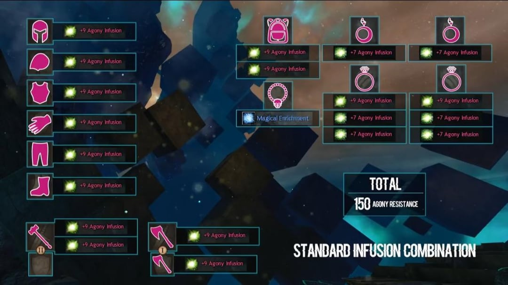
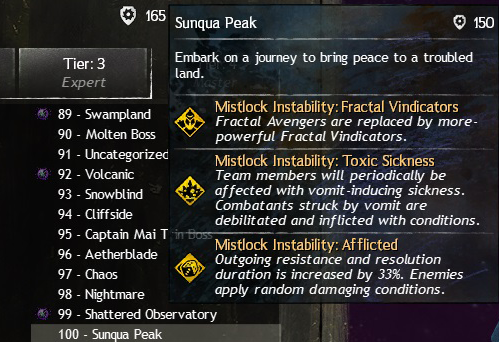
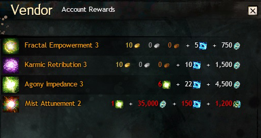
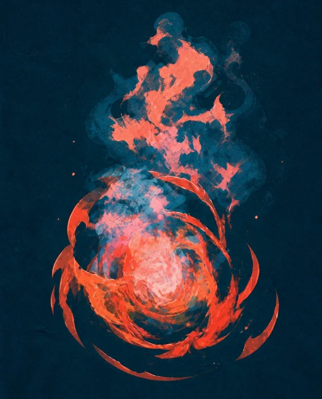

## Fundamentos

Chegue nas Fractals sabendo o que esperar e como sobreviver à Agony.

<Card icone="fractals">

### Introdução às Fractals

Se você já está no nível 80, pode jogar as Fractals: Dungeons avançadas,
parte do conteúdo Core (o jogo base). Elas se dividem em
**100 níveis** e **4 Tiers**, e quanto maior o nível,
maior a dificuldade e melhores as recompensas.

Para entrar num Tier, seu **nível de Fractal** precisa ser o dele
(de 1 a 100). Ele sobe sempre que você conclui uma Fractal de nível igual ou superior ao seu.

Para entrar numa Fractal, monte uma **<Termo def="Grupo de até 5 jogadores.">party</Termo>** e vá até o portal
de entrada, em **Fort Marriner**, em Lion's Arch
([Fort Marriner na Wiki](https://wiki.guildwars2.com/wiki/Fort_Marriner)).

Antes de começar, olhe a Mastery **Fractal Attunement**, de Central Tyria: ela libera alguns benefícios e mecânicas.
Para completá-la, você precisa de **11 pontos**.

<Banner imagem="fractals/artes/mistlock-observatory.jpg" alt="Mistlock Observatory, o hub das Fractals" />

</Card>

<Card icone="chart-column">

### Tiers e escalas

Hoje são **25 Fractals**, e cada nível da escala tem uma Fractal específica. Na tabela, a coluna AR mostra a Agony Resistance mínima que você precisa para a Agony causar o dano mínimo no último nível do Tier.

<Tabela legenda="Tiers das Fractals" legendaOculta>

| Tier | Níveis | Instabilidades | AR no último nível |
|---|---|--:|--:|
| 1 (Initiate) | 1 a 25 | 0 | 17 |
| 2 (Adept) | 26 a 50 | 1 | 61 |
| 3 (Expert) | 51 a 75 | 2 | 106 |
| 4 (Master) | 76 a 100 | 3 | 150 |

</Tabela>

A partir do nível 20 você já enfrenta a Agony. Do nível 75 em diante, um Fractal Avenger surge para finalizar quem fica em <Termo def="Estado em que o personagem cai ao chegar a 0 de vida: ainda usa algumas skills e pode ser revivido pelos aliados.">downed</Termo>.

</Card>

<Card icone="agony">

### Agony

Em certos momentos da Fractal, você leva a **Agony**: um debuff (efeito negativo) que causa dano por segundo e reduz a cura e a barreira que você recebe. É a principal diferença das Fractals para outros conteúdos instanciados.

Para aguentar a Agony, equipe **Agony Infusions**, que dão Agony Resistance ao personagem. Só dá para usá-las em equipamentos
**<Termo def="Raridade de equipamento acima de Exotic e abaixo de Legendary, com atributos maiores e Infusion Slots.">Ascended</Termo>** ou Legendary, os únicos que têm
Infusion Slots (encaixes para Infusions).

Você pode escolher entre as Infusions mais simples, que dão só Agony Resistance
(de +1 a +30), e as com status, que dão também atributos,
como Power e Condition Damage.

Como a Agony Resistance exigida sobe a cada Tier, para fazer todos os Tiers
você precisa de **150 de Agony Resistance**, com Infusions em todas as peças do set e slots extras nos anéis ou nas backpacks.

{/* PENDENTE (auditoria de direitos, 18/11/2026): imagem de origem desconhecida; o usuário vai gerar uma substituta. Ver design-system/auditoria-direitos.md */}

#### Aumentando os slots de Agony Infusion

Você pode ganhar slots extras em anéis e backpacks Ascended na **<Termo def="Forja que combina quatro itens para criar outro, seguindo receitas. A principal fica em Lion's Arch.">Mystic Forge</Termo>**.
Os anéis são o melhor caminho, porque saem mais baratos e mais fáceis.
Deixe-os Attuned e Infused: cada upgrade
dá um slot adicional, até o máximo de **3 slots** por anel.

<Item icone="attuned">**Receita Attuned**: [wiki.guildwars2.com/wiki/Attuned_equipment](https://wiki.guildwars2.com/wiki/Attuned_equipment#Acquisition)</Item>
<Item icone="infused">**Receita Infused**: [wiki.guildwars2.com/wiki/Infused_equipment](https://wiki.guildwars2.com/wiki/Infused_equipment#Acquisition)</Item>

<small>A imagem de Agony Resistance mostra como chegar a 150, o suficiente para todos os Tiers das Fractals.</small>

</Card>

<Card icone="instabilidade">

### Instabilidades

Do **Tier 2** em diante, a Fractal que você escolhe vem com **instabilidades**: mecânicas extras que a mudam. O Tier 2 tem uma
instabilidade, e o Tier 4 tem três.

Como as instabilidades sorteadas mudam **todo dia**, confira o efeito de cada uma
antes de entrar. A lista completa, com todos os efeitos, está na
[Wiki oficial](https://wiki.guildwars2.com/wiki/Fractals_of_the_Mists#Mistlock_Instability).

</Card>

<Card icone="recompensas">

### Recompensas

Quer as maiores recompensas? Faça as **Daily Fractals**: elas mudam
todo dia e dão recompensas extras, maiores conforme o Tier.

No painel das Fractals você encontra dois grupos de Fractals do dia: **Daily** e **Recommended**.
Faça os dois, porque dão as melhores recompensas.
Para ver a lista do dia, abra o painel de Achievements ou o próprio painel das Fractals.

<Banner imagem="fractals/artes/fractals-of-the-mists.jpg" alt="Recompensas Fractals: ilhas flutuantes nas Mists, com um portal brilhante sobre uma plataforma" />

<Item icone="repeat">**Daily (Tier N)**: todo dia há 3 Fractals diárias, as mesmas em todos os Tiers. Completar a daily em um Tier mais alto também completa a mesma daily nos Tiers abaixo e entrega os baús de todos eles. Todo baú de daily traz Pristine Fractal Relic e Agony Infusions +1. A rotação é de 15 dias.</Item>
<Item icone="target">**Recommended**: uma Fractal por dia nos Tiers 1 a 3 (não existe no Tier 4), sempre em um nível fixo. As de Adept e Expert exigem a Mastery **Follows Advice**. Cada uma dá um Research Chest com Fractal Research Page e uma Mist Potion grande.</Item>
<Item icone="refresh-cw">**Reset diário**: dailies e instabilidades mudam às 00:00 UTC (21:00 no horário de Brasília).</Item>
<Item icone="fractal-encryption">**Fractal Encryption**: caixa que contém materiais, Agony Infusions, Trophies, Fractal Encryption Keys e receitas para equipamentos Ascended.</Item>
<Item icone="fractal-encryption-key">**Fractal Encryption Key**: chave que abre as Fractal Encryptions.</Item>
<Item icone="fractal-relic">**Fractal Relics e Pristines**: moedas das Fractals, usadas para comprar equipamentos Ascended, Agony Infusions, poções, títulos e skins.</Item>
<Item icone="fractal-matrix">**Fractal Matrix**: material de crafting e moeda para comprar vários itens das Fractals.</Item>
<Item icone="mist-potion">**Mist Potions**: consumíveis que dão bônus de dano, proteção e movimento durante as Fractals.</Item>

</Card>

## Progressão e recompensas

Aqui você escolhe o próximo objetivo de longo prazo: a backpack lendária, os títulos ou o Challenge Mode.

<CardImagem imagem="fractals/ad-infinitum.jpg" alt="Ad Infinitum">

### Ad Infinitum (backpack lendária)

Quer uma backpack lendária? Nas Fractals você consegue a **Ad Infinitum**.
Para isso, faça Achievements dentro e fora das Fractals e use no crafting
materiais exclusivos das Fractals.

Para começar, procure o NPC **Kelvei, the Legendary Observer**,
um asura que fica dentro das Fractals of the Mists. Ele te dá o item **Theory of the Finite Result**. Ao usá-lo, você libera o
Achievement Ad Infinitum I: Finite Result, na aba _Legendary Backpacks_.

</CardImagem>

<Card icone="fractals-achievements">

### Conquistas e títulos

Nas Fractals você faz muitas conquistas com recompensas variadas. As principais dão **Mastery Points de Central Tyria** e são fáceis de conseguir.

Você também pode conquistar **quatro títulos**.
Enquanto você está dentro de uma Fractal, eles dão bônus de dano, regeneração de vida e Agony Resistance.
Para consegui-los, compre as
**Account Augmentations**, que também dão itens e Agony Infusions ao fim de cada Fractal.

<Aviso tipo="dica" titulo="Account Augmentations">Você compra com o NPC Deroir, no Mistlock Observatory. A Agony Impedance só pode ser comprada com nível pessoal de Fractal 100. Cada nível de Mist Attunement também soma 1 Fractal Encryption e uma bolsa extra de Fractal Relics ao baú do fim de cada Fractal. Custos: **MA1** Agony Infusion +13, 25.000 Relics, 75 Integrated Fractal Matrix e 8 Fractal Journals. **MA2** +14, 35.000 Relics, 150 Matrix e 1.200 Pristine Fractal Relics. **MA3** +15, 45.000 Relics, 225 Matrix e 16 Fractal Journals. **MA4** +16, 55.000 Relics, 300 Matrix e 2.000 Pristines. Fractal Journals são feitos com Fractal Research Pages, que vêm das Recommended.</Aviso>

<Item icone="fractal-savant">**Fractal Savant** <small>Requisitos:</small> Fractal Empowerment 2, Karmic Retribution 2, Agony Impedance 2, Mist Attunement 1. <small>Benefícios:</small> +5 Agony Resistance, +1% dano e +10 vida/s.</Item>
<Item icone="fractal-prodigy">**Fractal Prodigy** <small>Requisito:</small> Mist Attunement 2. <small>Benefícios:</small> +10 Agony Resistance, +2% dano e +25 vida/s (a tooltip do jogo mostra 20).</Item>
<Item icone="fractal-champion">**Fractal Champion** <small>Requisito:</small> Mist Attunement 3. <small>Benefícios:</small> +15 Agony Resistance, +4% dano e +50 vida/s.</Item>
<Item icone="fractal-god">**Fractal God** <small>Requisito:</small> Mist Attunement 4. <small>Benefícios:</small> +25 Agony Resistance, +7% dano e +100 vida/s.</Item>

</Card>

<Card icone="fractals-achievements">

### Challenge Mode (CM)

Quer um desafio maior? Assim como as Raids e os Raid Encounters, as Fractals têm um **modo de desafio**, o Challenge Mode (CM).
Hoje **sete** Fractals têm CM:

- 94: Solitary Throne
- 95: Kinfall
- 96: Nightmare
- 97: Shattered Observatory
- 98: Sunqua Peak
- 99: Silent Surf
- 100: Lonely Tower

Cada uma traz mecânicas
e desafios diferentes, e as recompensas são melhores.

Se você quer o título **Fractal God**, faça todo dia
todas as Fractals diárias: CM, Daily e Recommended. Assim você junta mais
Relics, Pristines e Matrix, que são o que os títulos custam.

Com essa rotina, você consegue o **Fractal God em 190 dias**.
Depois disso, suas recompensas diárias ficam bem melhores e o lucro cresce.

<Item icone="lock">**Como liberar o CM**: você usa o Challenge Mote, item que ativa o CM, no nível de CM da Fractal, no Tier 4. Em Nightmare e Sunqua Peak, só pode usá-lo quem completou o meta achievement daquela Fractal. Em Solitary Throne, você precisa ter concluído a Fractal no Tier 4. Se você não estiver presente quando o CM é ativado (aparece o efeito Challenge Mote Activated!), não recebe crédito de achievement pelo boss.</Item>

</Card>

## Todas as Fractals

Escolha entre as 25 Fractals, em ordem alfabética, e abra o vídeo, o guia ou a página da Wiki de cada uma.

<Card icone="fractals">

### Guias de cada Fractal

Cada Fractal tem uma linha com os botões **Vídeo**, Guia (texto) e Wiki. Os vídeos são da série *Get To The Point*, do canal MuklukYoutube (em inglês). Vinte Fractals estão num mesmo vídeo, e o botão Vídeo abre no trecho de cada uma.

Nas Fractals com Challenge Mode você também encontra o botão **Vídeo CM**, com um vídeo só do CM, e o botão **O que muda no CM**, logo abaixo do nome, que abre ali mesmo um resumo do que muda na luta. Em Solitary Throne, Kinfall e Lonely Tower, o Vídeo CM abre o guia completo de CMs da Syrma Gaming (30/09/2026, em inglês) já no trecho de cada uma.

Os guias escritos são da GuildJen (em inglês), e o de Solitary Throne é da Hardstuck. Imagens: capturas do jogo publicadas na Wiki oficial do Guild Wars 2 (a lista está nos [Créditos](/creditos.html#imagens)).

</Card>

<Wing nome="Aetherblade" arte="fractals/artes/aetherblade.jpg" alt="Aetherblade Fractal">
<Boss nome="Aetherblade" texto="Guias" video="https://www.youtube.com/watch?v=rAdgTpLf7mc&t=1325s" guia="https://guildjen.com/aetherblade-fractal-guide/" wiki="https://wiki.guildwars2.com/wiki/Aetherblade_Fractal"/>
</Wing>

<Wing nome="Aquatic Ruins" arte="fractals/artes/aquatic-ruins.jpg" alt="Aquatic Ruins Fractal">
<Boss nome="Aquatic Ruins" texto="Guias" video="https://www.youtube.com/watch?v=rAdgTpLf7mc&t=807s" guia="https://guildjen.com/aquatic-ruins-fractal-guide/" wiki="https://wiki.guildwars2.com/wiki/Aquatic_Ruins_Fractal"/>
</Wing>

<Wing nome="Captain Mai Trin Boss" arte="fractals/artes/captain-mai-trin-boss.jpg" alt="Captain Mai Trin Boss Fractal">
<Boss nome="Captain Mai Trin Boss" texto="Guias" video="https://www.youtube.com/watch?v=rAdgTpLf7mc&t=1576s" guia="https://guildjen.com/captain-mai-trin-boss-fractal-guide/" wiki="https://wiki.guildwars2.com/wiki/Captain_Mai_Trin_Boss_Fractal"/>
</Wing>

<Wing nome="Chaos" arte="fractals/artes/chaos.jpg" alt="Chaos Fractal">
<Boss nome="Chaos" texto="Guias" video="https://www.youtube.com/watch?v=rAdgTpLf7mc&t=1271s" guia="https://guildjen.com/chaos-fractal-guide/" wiki="https://wiki.guildwars2.com/wiki/Chaos_Fractal"/>
</Wing>

<Wing nome="Cliffside" arte="fractals/artes/cliffside.jpg" alt="Cliffside Fractal">
<Boss nome="Cliffside" texto="Guias" video="https://www.youtube.com/watch?v=rAdgTpLf7mc&t=744s" guia="https://guildjen.com/cliffside-fractal-guide/" wiki="https://wiki.guildwars2.com/wiki/Cliffside_Fractal"/>
</Wing>

<Wing nome="Deepstone" arte="fractals/artes/deepstone.jpg" alt="Deepstone Fractal">
<Boss nome="Deepstone" texto="Guias" video="https://www.youtube.com/watch?v=rAdgTpLf7mc&t=1084s" guia="https://guildjen.com/deepstone-fractal-guide/" wiki="https://wiki.guildwars2.com/wiki/Deepstone_Fractal"/>
</Wing>

<Wing nome="Kinfall" num="CM 95" arte="fractals/artes/kinfall.jpg" alt="Kinfall Fractal">
<Boss nome="Kinfall" texto="Guias" video="https://www.youtube.com/watch?v=vKmPfj5xU_Y" cm="https://www.youtube.com/watch?v=mOoNh8fD3s8&t=506s" guia="https://guildjen.com/kinfall-fractal-guide/" wiki="https://wiki.guildwars2.com/wiki/Kinfall_Fractal">

- Antes do boss, Elite Frost Wisps roubam o Life-Fire de quem chega perto. Eles não tomam dano: só somem, devolvendo o Life-Fire, quando alguém do squad quebra a defiance bar deles. Leve skills de CC (crowd control), que servem para isso.
- No boss, um X vermelho aparece em alguns dos círculos do Lofted Cryoflash. Nesses, não pise: entrar mata na hora.

</Boss>
</Wing>

<Wing nome="Lonely Tower" num="CM 100" arte="fractals/artes/lonely-tower.jpg" alt="Lonely Tower Fractal">
<Boss nome="Lonely Tower" texto="Guias" video="https://www.youtube.com/watch?v=pMJW5c4vtbM" cm="https://www.youtube.com/watch?v=mOoNh8fD3s8&t=2570s" guia="https://guildjen.com/the-lonely-tower-fractal-guide/" wiki="https://wiki.guildwars2.com/wiki/Lonely_Tower_Fractal" cmVida="~10 → 17 milhões">

- Quebrar a defiance bar não tira mais os stacks de empowerment do Eparch. Cada barra fica mais difícil que a anterior, então guarde CC.
- O debuff que reduz atributos não sai mais quando você interage com os glóbulos (no modo normal, são eles que limpam esse debuff), e cresce enquanto a barra não quebra.
- Em 65% e 35%, o Eparch sobe e abrem duas Kryptis Rifts, cada uma com um champion e vários inimigos menores.

</Boss>
</Wing>

<Wing nome="Molten Boss" arte="fractals/artes/molten-boss.jpg" alt="Molten Boss Fractal">
<Boss nome="Molten Boss" texto="Guias" video="https://www.youtube.com/watch?v=rAdgTpLf7mc&t=1050s" guia="https://guildjen.com/molten-boss-fractal-guide/" wiki="https://wiki.guildwars2.com/wiki/Molten_Boss_Fractal"/>
</Wing>

<Wing nome="Molten Furnace" arte="fractals/artes/molten-furnace.jpg" alt="Molten Furnace Fractal">
<Boss nome="Molten Furnace" texto="Guias" video="https://www.youtube.com/watch?v=rAdgTpLf7mc&t=1005s" guia="https://guildjen.com/molten-furnace-fractal-guide/" wiki="https://wiki.guildwars2.com/wiki/Molten_Furnace_Fractal"/>
</Wing>

<Wing nome="Nightmare" num="CM 96" arte="fractals/artes/nightmare.jpg" alt="Nightmare Fractal">
<Boss nome="Nightmare" texto="Guias" video="https://www.youtube.com/watch?v=rAdgTpLf7mc&t=1649s" cm="https://www.youtube.com/watch?v=HCujcXMJ430" guia="https://guildjen.com/nightmare-fractal-guide/" wiki="https://wiki.guildwars2.com/wiki/Nightmare_Fractal">

- As três lutas de boss (MAMA, Siax e Ensolyss) e as capturas de altar têm mecânicas diferentes das do modo normal. O **Vídeo CM** mostra cada uma.
- Cada boss derrotado dá uma recompensa extra.

> **Dica:** Chegue com a rotação da build já treinada e com food, utility e Mist Potions ativas.

</Boss>
</Wing>

<Wing nome="Shattered Observatory" num="CM 97" arte="fractals/artes/shattered-observatory.jpg" alt="Shattered Observatory Fractal">
<Boss nome="Shattered Observatory" texto="Guias" video="https://www.youtube.com/watch?v=rAdgTpLf7mc&t=1733s" cm="https://www.youtube.com/watch?v=HLkafqZ_f6A" guia="https://guildjen.com/shattered-observatory-fractal-guide/" wiki="https://wiki.guildwars2.com/wiki/Shattered_Observatory_Fractal">

- Até a fase final, o Skorvald ataca parecido com o modo normal, só que em área maior, com mais dano e mais rápido.

> **Dica:** Leve CC e saiba usar a tecla de ação especial. Um healer e alguém dando Stability para o grupo ajudam bastante.

</Boss>
</Wing>

<Wing nome="Silent Surf" num="CM 99" arte="fractals/artes/silent-surf.jpg" alt="Silent Surf Fractal">
<Boss nome="Silent Surf" texto="Guias" video="https://www.youtube.com/watch?v=o-G_OpGKmKo" cm="https://www.youtube.com/watch?v=5tsBszYg1_E" guia="https://guildjen.com/silent-surf-fractal-guide/" wiki="https://wiki.guildwars2.com/wiki/Silent_Surf_Fractal">

- O mote no começo leva até o último checkpoint, mas os Corrupted Luxon Sailors e o Corrupted First Mate Dolus continuam no caminho.
- Não tem mecânica nova. A diferença é que cair da plataforma mata e os ataques punem mais.
- O Harrowshot rouba os boons de quem é atingido.

</Boss>
</Wing>

<Wing nome="Siren's Reef" arte="fractals/artes/siren-s-reef.jpg" alt="Siren's Reef Fractal">
<Boss nome="Siren's Reef" texto="Guias" video="https://www.youtube.com/watch?v=rAdgTpLf7mc&t=1166s" guia="https://guildjen.com/sirens-reef-fractal-guide/" wiki="https://wiki.guildwars2.com/wiki/Siren's_Reef_Fractal"/>
</Wing>

<Wing nome="Snowblind" arte="fractals/artes/snowblind.jpg" alt="Snowblind Fractal">
<Boss nome="Snowblind" texto="Guias" video="https://www.youtube.com/watch?v=rAdgTpLf7mc&t=570s" guia="https://guildjen.com/snowblind-fractal-guide/" wiki="https://wiki.guildwars2.com/wiki/Snowblind_Fractal"/>
</Wing>

<Wing nome="Solid Ocean" arte="fractals/artes/solid-ocean.jpg" alt="Solid Ocean Fractal">
<Boss nome="Solid Ocean" texto="Guias" video="https://www.youtube.com/watch?v=rAdgTpLf7mc&t=1609s" guia="https://guildjen.com/solid-ocean-fractal-guide/" wiki="https://wiki.guildwars2.com/wiki/Solid_Ocean_Fractal"/>
</Wing>

<Wing nome="Solitary Throne" num="CM 94" arte="fractals/artes/solitary-throne.jpg" alt="Solitary Throne Fractal">
<Boss nome="Solitary Throne" texto="Guias" video="https://www.youtube.com/watch?v=jn1zD_lNaFk" cm="https://www.youtube.com/watch?v=mOoNh8fD3s8&t=37s" guia="https://hardstuck.gg/gw2/guides/fractals/solitary-throne/" wiki="https://wiki.guildwars2.com/wiki/Solitary_Throne_Fractal">

- É o CM mais novo, lançado em setembro de 2026. Para ativar, conclua a Fractal no Tier 4 e aceite o desafio do Harbinger.
- Cada plataforma limpa abre um portal direto para a próxima.

A Wiki ainda não detalha o resto das mudanças. O vídeo do botão **CM** mostra a luta inteira.

</Boss>
</Wing>

<Wing nome="Sunqua Peak" num="CM 98" arte="fractals/artes/sunqua-peak.jpg" alt="Sunqua Peak Fractal">
<Boss nome="Sunqua Peak" texto="Guias" video="https://www.youtube.com/watch?v=qlTxvKghTFc" cm="https://www.youtube.com/watch?v=RvMjGfPfi64" guia="https://guildjen.com/sunqua-peak-fractal-guide/" wiki="https://wiki.guildwars2.com/wiki/Sunqua_Peak_Fractal">

- O portal do Harbinger of Woe pula os minibosses e leva direto para a boss final, a Ai, Keeper of the Peak.
- Até 1% de vida a luta lembra a do modo normal, só que pune mais. Na tempestade de ar, por exemplo, são 8 fontes de energia para dissipar, e não 6.

</Boss>
</Wing>

<Wing nome="Swampland" arte="fractals/artes/swampland.jpg" alt="Swampland Fractal">
<Boss nome="Swampland" texto="Guias" video="https://www.youtube.com/watch?v=rAdgTpLf7mc&t=692s" guia="https://guildjen.com/swampland-fractal-guide/" wiki="https://wiki.guildwars2.com/wiki/Swampland_Fractal"/>
</Wing>

<Wing nome="Thaumanova Reactor" arte="fractals/artes/thaumanova-reactor.jpg" alt="Thaumanova Reactor Fractal">
<Boss nome="Thaumanova Reactor" texto="Guias" video="https://www.youtube.com/watch?v=rAdgTpLf7mc&t=1361s" guia="https://guildjen.com/thaumanova-reactor-fractal-guide/" wiki="https://wiki.guildwars2.com/wiki/Thaumanova_Reactor_Fractal"/>
</Wing>

<Wing nome="Twilight Oasis" arte="fractals/artes/twilight-oasis.jpg" alt="Twilight Oasis Fractal">
<Boss nome="Twilight Oasis" texto="Guias" video="https://www.youtube.com/watch?v=rAdgTpLf7mc&t=1479s" guia="https://guildjen.com/twilight-oasis-fractal-guide/" wiki="https://wiki.guildwars2.com/wiki/Twilight_Oasis_Fractal"/>
</Wing>

<Wing nome="Uncategorized" arte="fractals/artes/uncategorized.jpg" alt="Uncategorized Fractal">
<Boss nome="Uncategorized" texto="Guias" video="https://www.youtube.com/watch?v=rAdgTpLf7mc&t=512s" guia="https://guildjen.com/uncategorized-fractal-guide/" wiki="https://wiki.guildwars2.com/wiki/Uncategorized_Fractal"/>
</Wing>

<Wing nome="Underground Facility" arte="fractals/artes/underground-facility.jpg" alt="Underground Facility Fractal">
<Boss nome="Underground Facility" texto="Guias" video="https://www.youtube.com/watch?v=rAdgTpLf7mc&t=884s" guia="https://guildjen.com/underground-facility-fractal-guide/" wiki="https://wiki.guildwars2.com/wiki/Underground_Facility_Fractal"/>
</Wing>

<Wing nome="Urban Battleground" arte="fractals/artes/urban-battleground.jpg" alt="Urban Battleground Fractal">
<Boss nome="Urban Battleground" texto="Guias" video="https://www.youtube.com/watch?v=rAdgTpLf7mc&t=623s" guia="https://guildjen.com/urban-battleground-fractal/" wiki="https://wiki.guildwars2.com/wiki/Urban_Battleground_Fractal"/>
</Wing>

<Wing nome="Volcanic" arte="fractals/artes/volcanic.jpg" alt="Volcanic Fractal">
<Boss nome="Volcanic" texto="Guias" video="https://www.youtube.com/watch?v=rAdgTpLf7mc&t=441s" guia="https://guildjen.com/volcanic-fractal-guide/" wiki="https://wiki.guildwars2.com/wiki/Volcanic_Fractal"/>
</Wing>
