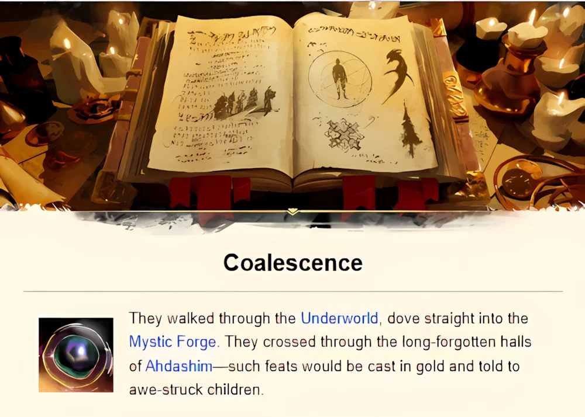
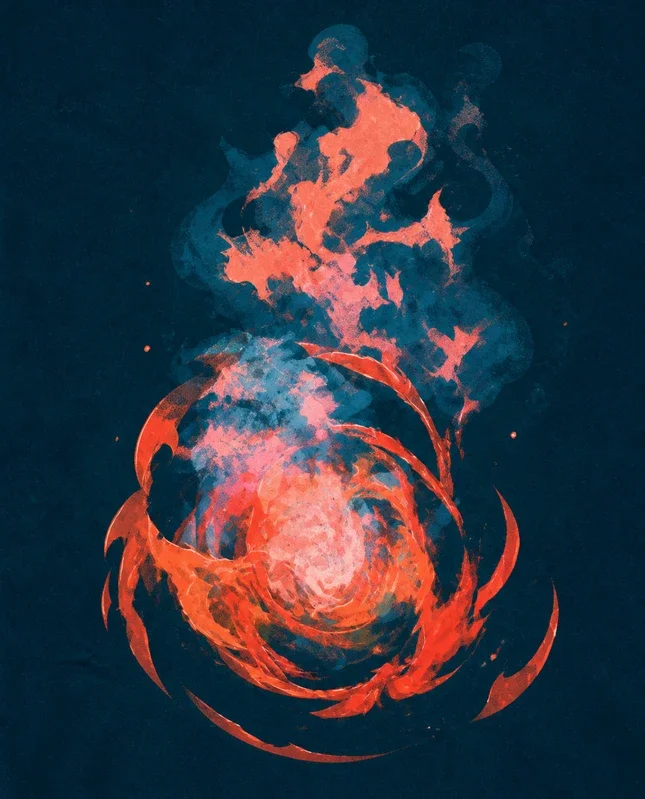

## Introdução e fundamentos

Chegue na sua primeira raid sabendo como o squad funciona, o que cada luta dá de recompensa e como escolher a dificuldade.

<Card icone="introducao-as-raids">

### Introdução às Raids

Se você quer enfrentar bosses em um squad de **10 jogadores**, é nas **Raids** que a gente joga. São instâncias de nível 80 que podem ter só um boss (*Raid Encounter*) ou uma sequência de bosses e eventos (*Wing*).

Há Raids nas expansões <Chip nome icone="mastery-heart-of-thorns">Heart of Thorns</Chip> <Chip nome icone="mastery-path-of-fire">Path of Fire</Chip> <Chip nome icone="mastery-end-of-dragons">End of Dragons</Chip> <Chip nome icone="mastery-secrets-of-the-obscure">Secrets of the Obscure</Chip> <Chip nome icone="mastery-janthir-wilds">Janthir Wilds</Chip> <Chip nome icone="mastery-visions-of-eternity">Visions of Eternity</Chip> e nas Living Worlds <Chip nome icone="mastery-central-tyria">Season 1</Chip> <Chip nome icone="mastery-icebrood-saga">Icebrood Saga</Chip>.

Para entrar nas Raids, vá até o portal que fica dentro do **Lion's Arch Aerodrome** ([Aerodrome Waypoint](https://wiki.guildwars2.com/wiki/Lion%27s_Arch_Aerodrome)).

Antes de entrar, vale olhar a **Mastery Raids**, na trilha de Heart of Thorns: algumas mecânicas das Raids dependem dela. Para ter a Mastery completa, você precisa de **8 pontos**.

<Banner imagem="raids/artes/portal-do-aerodrome.jpg" alt="Portal de Raids no Aerodrome: um grupo de aventureiros diante de um portal vermelho entre ruínas" />

<Item icone="lock">**Acesso por expansão**: Quickplay e Old Lion's Court são liberados para todos. As Raids de Heart of Thorns e Path of Fire abrem para quem tem a expansão (os encontros da Icebrood Saga exigem Path of Fire). Para abrir os encontros de End of Dragons, Secrets of the Obscure e Visions of Eternity, você precisa ter completado as missões de história correspondentes. Mesmo sem isso, dá para entrar em instâncias abertas por outros jogadores.</Item>

<Item icone="settings">**Masteries obrigatórias**: Wing 1 exige Glider Basics e Updraft Use. Wing 2 exige Updraft Use e Bouncing Mushrooms. Wing 3 exige Ley Line Gliding e Bouncing Mushrooms. Wing 4 exige Glider Basics. Em Mount Balrior, recomendamos levar a Warclaw.</Item>

</Card>

<Card icone="raids-recompensas">

### Recompensas

Você pode voltar às Raids toda semana por gold, equipamentos e moedas exclusivas: as recompensas são **semanais**.

<Banner imagem="raids/artes/recompensas-de-raid.jpg" alt="Aerodrome de Lion's Arch: dirigíveis suspensos entre correntes e engrenagens" />

<Item icone="refresh-cw">**Reset semanal**: as recompensas especiais de cada encontro valem uma vez por semana. O reset é toda segunda-feira às 07:30 UTC (04:30 no horário de Brasília). O Emboldened e o Call of the Mists passam para outra Raid uma hora depois, às 08:30 UTC. As Daily Raid Bounties (quatro achievements por dia, cada um com um coffer extra) resetam às 00:00 UTC (21:00 em Brasília).</Item>

<Item icone="chart-column">**Limite de Magnetite Shard**: 800 por semana. Quando você passa disso, o boss entrega o item No Reward no lugar da moeda. Os encontros da expansão mais recente dão Gaeting Crystal em vez de Magnetite Shard, com limite de 150 por semana. Os 10 Magnetite Shards extras do Challenge Mode ficam fora desses limites.</Item>

<Item icone="magnetite-shard">**Magnetite Shard**: a moeda principal das Raids, que você ganha ao derrotar bosses e concluir eventos. Serve para comprar equipamentos ascended, infusions, materiais e decorações.</Item>

<Item icone="legendary-insight">**Legendary Insight (LI)**: moeda que você ganha ao derrotar bosses, nas *Daily Raid Bounties* e no achievement semanal de Quickplay. Serve para craftar armaduras e o anel lendário das Raids.</Item>

<Item icone="provisioner-token">**Provisioner Token**: você consegue trocando itens com os *Faction Provisioners*. Desde fev/2026, o Challenge Mode não dá mais esse item. Serve para craftar armaduras, sigils e runas lendárias.</Item>

#### Baús especiais

<Item icone="vigil-emissary-chest">**Vigil Emissary Chest**: baú semanal no Eye of the North, com 5 orbes que se ativam ao completar as Raids da Icebrood Saga. Quanto mais orbes ativos, melhores as recompensas.</Item>

<Item icone="essence-chest">**Essence Chests**: baús encontrados principalmente em **Bjora Marches** (alguns também nos encontros da Icebrood Saga): *Valor*, *Resilience* e *Vigilance*. Para abrir cada um, você precisa do tier correspondente da Mastery **Essence Manipulation**.</Item>

</Card>

<Card icone="envoy-armor-armadura-lendaria" sumario="Envoy Armor">

### Envoy Armor (armadura lendária)

Quer uma armadura lendária jogando Raids? A **Envoy Armor** vem de Achievements feitos dentro e fora das Raids de Heart of Thorns, e você precisa juntar **Legendary Insights** suficientes.

Para começar, derrote qualquer boss de Raid e pegue o item **The Lost Art of Armor Crafting**. Isso libera o Achievement [Envoy Armor I: Experimental Armor](https://wiki.guildwars2.com/wiki/Envoy_Armor_I:_Experimental_Armor) na aba *Legendary Armor*.

<Banner imagem="raids/envoy-armor.jpg" alt="Envoy Armor" />

</Card>

<Card icone="coalescence-anel-lendario" sumario="Coalescence">

### Coalescence (anel lendário)

Prefere um anel? O **Coalescence** é o anel lendário das Raids. Ele vem de Achievements feitos dentro e fora das Raids de Path of Fire, e você também gasta **Legendary Insights** nele.

Para começar, derrote qualquer boss de Raid e interaja com o **Loot Chest**. Isso libera o Achievement [Coalescence I: Unbridled](https://wiki.guildwars2.com/wiki/Coalescence_I:_Unbridled) na aba *Legendary Trinkets*.

</Card>

<Card icone="introducao-as-raids">

### Tiers de dificuldade

Você escolhe a dificuldade da luta: como nas outras instâncias do jogo, as Raids têm mais de um tier, e o **Challenge Mode** (Desafio) dá recompensas melhores.

Para jogar no **Normal Mode**, você não precisa ativar nada. O Challenge Mode e o Legendary Mode você liga no **Challenge Mote**, um objeto parecido com uma chama flutuante que fica perto do boss.

<Item icone="emboldened">**Emboldened**: efeito aplicado a uma Raid por semana, que aumenta o dano, a cura e a vida do seu squad. A cada derrota do squad (wipe), o buff fica mais forte, então ele ajuda quem está começando, e as recompensas não mudam. Se você ativar o Challenge Mode, o Emboldened desliga. Com o Emboldened ligado, alguns achievements ficam bloqueados, como Undefeated e Down, Down, Downed.</Item>

<Abas rotulo="Modos de dificuldade das Raids" class="abas-lado-a-lado">
<Aba rotulo="Normal Mode" icone="normal-mode">

É o modo padrão: você joga sem efeitos extras, os bosses mantêm as mecânicas de sempre e as recompensas são as básicas.

</Aba>
<Aba rotulo="Challenge Mode" icone="challenge-mode">

Você ativa o modo antes de cada boss. A vida do boss e algumas mecânicas mudam, e em troca as recompensas são melhores.

</Aba>
<Aba rotulo="Legendary Mode" icone="legendary-mode">

É o Challenge Mode ainda mais difícil: poucas mecânicas mudam, mas a vida do boss é bem maior. A sua recompensa é um título colorido.

</Aba>
</Abas>

<Item icone="call-of-the-mists">**Call of the Mists**: efeito aplicado a uma Raid por semana. Você ganha **o dobro de gold** e de experiência ao completar os bosses daquela Raid, em qualquer modo.</Item>

</Card>

<Card icone="trophy" semSumario>

### Onde há Challenge Mode e Legendary Mode

Antes de ativar o Challenge Mode (CM) no **Challenge Mote**, perto do boss, confira se o encontro tem essa opção: nem todos têm.

<Item icone="swords">**Wings**: Wings 1 e 2 não têm CM. Wing 3: só Keep Construct. Wing 5: Soulless Horror e Dhuum. Wings 4, 6, 7 e 8: todos os bosses. Em Mount Balrior, o mote de Decima só aparece depois de derrotar o legendary sentient conduit.</Item>

<Item icone="puzzle">**Raid Encounters**: têm CM o Old Lion's Court, os quatro de End of Dragons, Cosmic Observatory, Temple of Febe, Guardian's Glade e Nexus of Eternity. Na Icebrood Saga, só Forging Steel tem desafios opcionais, e apenas em instância de squad.</Item>

<Item icone="zap">**Legendary Mode**: existe em Ura (Mount Balrior), Cerus (Temple of Febe) e Vloxx (Nexus of Eternity), ativado no mesmo Challenge Mote.</Item>

<Item icone="coins">**Recompensa extra do CM**: uma vez por semana em cada boss, você ganha 2 gold, 10 Magnetite Shards, experiência e uma peça exótica, além das recompensas do Normal Mode.</Item>

</Card>

<Card icone="quickplay">

### Quickplay

Se você ainda tem pouca experiência, o **Quickplay** foi pensado para você. O jogo monta um squad com jogadores sorteados, e vocês enfrentam uma Raid escolhida ao acaso entre as disponíveis.

Ao entrar, você e o seu squad recebem o buff **Quickplay Morale**, com bônus de dano e de defesa, e fica mais fácil aprender a luta.

**Como acessar:** janela social (<kbd>Y</kbd>) → *Looking for Group* → *Raids* → *Raids (Training)*.

<Banner imagem="raids/artes/quickplay.jpg" alt="Quickplay: um grupo enfrenta uma criatura gigante de olhos verdes entre colunas" />

<Aviso tipo="atencao">Os encontros que você faz no Quickplay não contam para as Daily Raid Bounties, para o achievement Weekly Raid Encounters nem para o Vigil Emissary Chest. A recompensa semanal de cada encontro é 5.000 de karma e experiência. O sorteio vale para 8 encontros: Old Lion's Court, Aetherblade Hideout, Xunlai Jade Junkyard, Kaineng Overlook, Boneskinner, Whisper of Jormag, Cosmic Observatory e Temple of Febe.</Aviso>

</Card>

## Raid Wings

Escolha a sua próxima wing: aqui estão as 8, com os bosses em ordem de progressão e um vídeo de referência de cada um.

<LinhaDoTempo rotulo="Raid Wings em ordem">
<Marco rotulo="Wing 1" nome="Spirit Vale" href="#spirit-vale" detalhes={['4 encontros', 'sem CM']} />
<Marco rotulo="Wing 2" nome="Salvation Pass" href="#salvation-pass" detalhes={['3 encontros', 'sem CM']} />
<Marco rotulo="Wing 3" nome="Stronghold of the Faithful" href="#stronghold-of-the-faithful" detalhes={['4 encontros', 'CM só em Keep Construct']} />
<Marco rotulo="Wing 4" nome="Bastion of the Penitent" href="#bastion-of-the-penitent" detalhes={['4 encontros', 'CM em todos']} />
<Marco rotulo="Wing 5" nome="Hall of Chains" href="#hall-of-chains" detalhes={['4 encontros', 'CM em Soulless Horror e Dhuum']} />
<Marco rotulo="Wing 6" nome="Mythwright Gambit" href="#mythwright-gambit" detalhes={['3 encontros', 'CM em todos']} />
<Marco rotulo="Wing 7" nome="The Key of Ahdashim" href="#the-key-of-ahdashim" detalhes={['3 encontros', 'CM em todos']} />
<Marco rotulo="Wing 8" nome="Mount Balrior" href="#mount-balrior" detalhes={['3 encontros', 'CM em todos', 'Legendary Mode em Ura']} />
</LinhaDoTempo>

<Aviso tipo="dica" titulo="Botões de cada boss">Cada boss tem uma linha de botões para você se preparar. "Vídeo" abre um guia curto da série *Get To The Point*, do canal MuklukYoutube (em inglês). "Vídeo CM" abre um vídeo só do Challenge Mode daquele boss. "Guia" abre o guia em texto da Snow Crows, quando existe. "Wiki" abre a página do encontro na Guild Wars 2 Wiki. Nos bosses que têm Challenge Mode, o botão "O que muda no CM", logo abaixo do nome, abre ali mesmo um resumo do que muda na luta (feito com base na Guild Wars 2 Wiki). Se CC, AoE ou defiance bar forem novidade para você, estão explicados no guia de Endgame.</Aviso>

<Wing nome="SPIRIT VALE" num="WING 1" arte="raids/artes/wing-1-spirit-vale-sabetha.jpg" alt="Spirit Vale" sumario="Wing 1: Spirit Vale">
<Boss nome="Vale Guardian" video="https://www.youtube.com/watch?v=qtzMDCVHlLg" guia="https://snowcrows.com/guides/raids/spirit-vale/vale-guardian" wiki="https://wiki.guildwars2.com/wiki/Vale_Guardian"/>
<Boss nome="Spirit Woods" video="https://www.youtube.com/watch?v=Ni_-HkRtmm4" guia="https://snowcrows.com/guides/raids/spirit-vale/spirit-woods" wiki="https://wiki.guildwars2.com/wiki/Spirit_Woods"/>
<Boss nome="Gorseval the Multifarious" video="https://www.youtube.com/watch?v=B9qbuP9kv4Q" guia="https://snowcrows.com/guides/raids/spirit-vale/gorseval" wiki="https://wiki.guildwars2.com/wiki/Gorseval_the_Multifarious"/>
<Boss nome="Sabetha the Saboteur" video="https://www.youtube.com/watch?v=4bqwSrZ2Sr4" guia="https://snowcrows.com/guides/raids/spirit-vale/sabetha" wiki="https://wiki.guildwars2.com/wiki/Sabetha_the_Saboteur"/>
</Wing>

<Wing nome="SALVATION PASS" num="WING 2" arte="raids/artes/wing-2-salvation-pass-matthias.jpg" alt="Salvation Pass" sumario="Wing 2: Salvation Pass">
<Boss nome="Slothasor" video="https://www.youtube.com/watch?v=WIBTTAPd3ME" guia="https://snowcrows.com/guides/raids/salvation-pass/slothasor" wiki="https://wiki.guildwars2.com/wiki/Slothasor"/>
<Boss nome="Bandit Trio" video="https://www.youtube.com/watch?v=ncVYseut8ag" guia="https://snowcrows.com/guides/raids/salvation-pass/bandit-trio" wiki="https://wiki.guildwars2.com/wiki/Bandit_Trio"/>
<Boss nome="Matthias Gabrel" video="https://www.youtube.com/watch?v=q99ocDpSnAI" guia="https://snowcrows.com/guides/raids/salvation-pass/matthias-gabrel" wiki="https://wiki.guildwars2.com/wiki/Matthias_Gabrel"/>
</Wing>

<Wing nome="STRONGHOLD OF THE FAITHFUL" num="WING 3" arte="raids/artes/wing-3-stronghold-xera.jpg" alt="Stronghold of the Faithful" sumario="Wing 3: Stronghold of the Faithful">
<Boss nome="Siege the Stronghold" video="https://www.youtube.com/watch?v=WFwcnj74lwU" guia="https://snowcrows.com/guides/raids/stronghold-faithful/siege-the-stronghold" wiki="https://wiki.guildwars2.com/wiki/Siege_the_Stronghold"/>
<Boss nome="Keep Construct" video="https://www.youtube.com/watch?v=QIdzfDtxaFQ" cm="https://www.youtube.com/watch?v=Hwd7v0Vr2eY&t=53s" guia="https://snowcrows.com/guides/raids/stronghold-faithful/keep-construct" wiki="https://wiki.guildwars2.com/wiki/Keep_Construct">

- O CM tem nome próprio: *Down, Down, Downed*.
- Um anel vermelho aparece na borda da arena e causa dano o tempo todo em quem estiver nele. Lute longe da beirada.
- Mate as Mesmer Projections separadas: se duas se encostarem, viram uma Insidious Projection, bem mais perigosa.

</Boss>
<Boss nome="Twisted Castle" video="https://www.youtube.com/watch?v=mRwLCQ7rUTw" guia="https://snowcrows.com/guides/raids/stronghold-faithful/twisted-castle" wiki="https://wiki.guildwars2.com/wiki/Twisted_Castle"/>
<Boss nome="Xera" video="https://www.youtube.com/watch?v=Iggsq-f3yBw" guia="https://snowcrows.com/guides/raids/stronghold-faithful/xera" wiki="https://wiki.guildwars2.com/wiki/Xera"/>
</Wing>

<Wing nome="BASTION OF THE PENITENT" num="WING 4" arte="raids/artes/wing-4-bastion-deimos.jpg" alt="Bastion of the Penitent" sumario="Wing 4: Bastion of the Penitent">
<Boss nome="Cairn the Indomitable" video="https://www.youtube.com/watch?v=zPfLE1wwWkw" cm="https://www.youtube.com/watch?v=Hwd7v0Vr2eY&t=63s" guia="https://snowcrows.com/guides/raids/bastion-penitent/cairn-the-indomitable" wiki="https://wiki.guildwars2.com/wiki/Cairn_the_Indomitable">

- Seu squad inteiro precisa usar o Celestial Dash (a skill de ação especial do encontro) pelo menos uma vez a cada 10 segundos. Fique de olho no efeito Countdown, na barra de efeitos: ele mostra quanto tempo falta.
- Se o tempo acabar, o dash sai sozinho, na distância máxima e para onde o seu personagem estiver virado.
- Você ganha 1 stack de Unseen Burden por segundo, e isso deixa o personagem mais lento. No CM, quem chega a 99 stacks vira pedra e perde as skills.

> **Dica:** Entrar nos círculos verdes tira stacks de Unseen Burden. Mesmo virado pedra, dá para usar o Celestial Dash até um círculo verde.

</Boss>
<Boss nome="Mursaat Overseer" video="https://www.youtube.com/watch?v=iHMzAPWoLDU" cm="https://www.youtube.com/watch?v=Hwd7v0Vr2eY&t=94s" guia="https://snowcrows.com/guides/raids/bastion-penitent/mursaat-overseer" wiki="https://wiki.guildwars2.com/wiki/Mursaat_Overseer" cmVida="22 → 30 milhões">

- A cada 30 segundos, alguns quadrados do chão acendem em azul por 4 segundos. Quem não estiver em cima de um quadrado azul quando o tempo acaba, morre.
- Cada jogador vê um desenho diferente, então não adianta seguir o colega: olhe o seu chão.

> **Dica:** Sempre existe um quadrado azul encostado no seu, às vezes na diagonal. Um passo costuma bastar.

</Boss>
<Boss nome="Samarog" video="https://www.youtube.com/watch?v=pLudL0RBgf0" cm="https://www.youtube.com/watch?v=Hwd7v0Vr2eY&t=136s" guia="https://snowcrows.com/guides/raids/bastion-penitent/samarog" wiki="https://wiki.guildwars2.com/wiki/Samarog" cmVida="30 → 40 milhões">

- Não tem mecânica nova: as mesmas da luta normal vêm mais cedo, mais vezes e punem mais.
- O Inevitable Betrayal (os dois círculos que marcam dois jogadores) já aparece na fase 1. Quem tem o círculo grande fica imobilizado, então quem tem o pequeno é que precisa correr até ele.
- Quando o círculo grande termina de carregar, cai uma lança em cima de quem estava com ele. Seu squad, principalmente o tank, precisa sair de perto.
- Esse ataque se repete a cada 24 segundos na fase 1, 19 na fase 3 e 14 na última.
- As lanças do Spear Impact caem sempre no mesmo desenho e não podem ser destruídas. Quando as 12 estão no chão, o Samarog puxa todas.

> **Dica:** Fique de olho no enrage, o tempo limite da luta: quando ele chega, o boss passa a matar todo mundo. Para o seu squad não chegar nele, deixe o Samarog com 66% de vida quando o timer marcar uns 8:30 restantes e abaixo de 33% antes dos 3:00 restantes.

</Boss>
<Boss nome="Deimos" video="https://www.youtube.com/watch?v=gW5HH36X3zU" cm="https://www.youtube.com/watch?v=Hwd7v0Vr2eY&t=189s" guia="https://snowcrows.com/guides/raids/bastion-penitent/deimos" wiki="https://wiki.guildwars2.com/wiki/Deimos" cmVida="36 → 42 milhões">

- Como o Saul fica preso e não ajuda na luta, ninguém faz a proteção no centro contra o Mind Crush. Quem estiver lá precisa de outra defesa, como Aegis.
- Também não dá para curar o Saul, então as Prides e Greeds precisam morrer antes de chegar nele.
- O Unnatural Signet não vai para o Deimos, então seu squad causa menos dano, e o hand kiter, quem puxa as mãos, fica sem o estandarte de cura.

</Boss>
</Wing>

<Wing nome="HALL OF CHAINS" num="WING 5" arte="raids/artes/wing-5-hall-of-chains-dhuum.jpg" alt="Hall of Chains" sumario="Wing 5: Hall of Chains">
<Boss nome="Soulless Horror" video="https://www.youtube.com/watch?v=Nw6D9_RcJhs" cm="https://www.youtube.com/watch?v=Hwd7v0Vr2eY&t=232s" guia="https://snowcrows.com/guides/raids/hall-chains/soulless-horror" wiki="https://wiki.guildwars2.com/wiki/Soulless_Horror" cmVida="igual ao normal">

- Os stacks que os tanks acumulam sobem mais rápido, então a troca de tank vem mais cedo.
- Os flesh wurms não param de nascer: continuam aparecendo a luta toda.
- A plataforma já começa com um anel a menos. Sobra menos espaço para se mexer.

</Boss>
<Boss nome="River of Souls" video="https://www.youtube.com/watch?v=-84PZQGCmyI" guia="https://snowcrows.com/guides/raids/hall-chains/river-of-souls" wiki="https://wiki.guildwars2.com/wiki/River_of_Souls"/>
<Boss nome="Statues of Grenth" video="https://www.youtube.com/watch?v=cKUcf_ez9Ec" guia="https://snowcrows.com/guides/raids/hall-chains/statues-of-grenth" wiki="https://wiki.guildwars2.com/wiki/Statues_of_Grenth"/>
<Boss nome="Dhuum" video="https://www.youtube.com/watch?v=5gFxLKJI9ds" cm="https://www.youtube.com/watch?v=Hwd7v0Vr2eY&t=259s" guia="https://snowcrows.com/guides/raids/hall-chains/dhuum" wiki="https://wiki.guildwars2.com/wiki/Dhuum" cmVida="32 → 40 milhões">

- O CM tem nome próprio: *The Voice in the Void*.
- Aparece o Ender's Echo, uma versão pequena do Dhuum que não ataca. Ele atravessa a arena em linha reta, muda de direção quando bate na parede e prende quem estiver no caminho.
- Fique fora da linha do Echo. Quem volta do Dhuum's Harvest fica protegido dele por alguns instantes.

</Boss>
</Wing>

<Wing nome="MYTHWRIGHT GAMBIT" num="WING 6" arte="raids/artes/wing-6-mythwright-gambit-qadim.jpg" alt="Mythwright Gambit" sumario="Wing 6: Mythwright Gambit">
<Boss nome="Conjured Amalgamate" video="https://www.youtube.com/watch?v=B7VQAZuV-6o" cm="https://www.youtube.com/watch?v=Hwd7v0Vr2eY&t=299s" guia="https://snowcrows.com/guides/raids/mythwright-gambit/conjured-amalgamate" wiki="https://wiki.guildwars2.com/wiki/Conjured_Amalgamate">

- Os braços ficam vulneráveis por 8 segundos depois de cada golpe (no normal são 10), e cada golpe já solta 3 Swords ou Shields.
- Depois do primeiro <Termo def="Fase em que o boss fica vulnerável e o squad solta todo o dano.">burn</Termo>, quatro Conjured Scepters aparecem fora da arena a cada 28 a 30 segundos e disparam lasers num jogador. O alvo fica com uma coluna de luz em cima e borda amarela na tela.
- Esse jogador morre direto se a vida zerar, sem passar pelo downed. O laser não pode ser esquivado, refletido nem anulado com invulnerabilidade.

> **Dica:** Só block segura o laser. Outro jogador (ou um <Termo def="Inimigo extra que aparece durante a luta.">add</Termo> de Sword ou Shield) entrando na frente também protege o alvo.

</Boss>
<Boss nome="Twin Largos" video="https://www.youtube.com/watch?v=RUQQhyE_YiA" cm="https://www.youtube.com/watch?v=Hwd7v0Vr2eY&t=346s" guia="https://snowcrows.com/guides/raids/mythwright-gambit/twin-largos" wiki="https://wiki.guildwars2.com/wiki/Twin_Largos">

- A cada 20% de vida, os bosses ganham uma barreira enorme e soltam um ataque que acerta a plataforma inteira, parecido com o World Eater do Gorseval.

> **Dica:** Quando o ataque começar, pule numa das fontes em volta da plataforma: elas devolvem todo mundo para o meio.

</Boss>
<Boss nome="Qadim" video="https://www.youtube.com/watch?v=nU_yQtk_8oo" cm="https://www.youtube.com/watch?v=Hwd7v0Vr2eY&t=372s" guia="https://snowcrows.com/guides/raids/mythwright-gambit/qadim" wiki="https://wiki.guildwars2.com/wiki/Qadim">

- Uma bola de fogo grande quica pelas plataformas no sentido anti-horário. Quem é atingido cai em downed, e quem já estava downed morre.
- Ela tem círculo de aviso (<Termo def="Área de efeito: o círculo ou forma no chão onde um ataque vai cair.">AoE</Termo>): dá para bloquear, esquivar ou só sair do círculo. Não aparece nos burns, no jumping puzzle nem dentro da lâmpada.
- Cair da área jogável mata.
- Nos burns, o Qadim ganha <Termo def="Barra que aparece sobre o boss e só diminui com CC (controle). Quebrada, o boss fica atordoado por um tempo.">defiance bar</Termo> depois de toda shockwave (no normal, é uma sim, outra não). As plataformas atingidas pelas AoEs são destruídas em vez de virar lava.

</Boss>
</Wing>

<Wing nome="THE KEY OF AHDASHIM" num="WING 7" arte="raids/artes/wing-7-key-of-ahdashim-qadim-the-peerless.jpg" alt="The Key of Ahdashim" sumario="Wing 7: The Key of Ahdashim">
<Boss nome="Cardinal Adina" video="https://www.youtube.com/watch?v=T_RwWm0Jj4k" cm="https://www.youtube.com/watch?v=Hwd7v0Vr2eY&t=435s" guia="https://snowcrows.com/guides/raids/key-ahdashim/cardinal-adina" wiki="https://wiki.guildwars2.com/wiki/Cardinal_Adina">

- Cair na areia movediça mata.
- Quando ela troca de fase, aparecem três paredes de areia em vez de duas.
- Todo pilar destruído deixa um buraco no chão, e cair nele também mata.

> **Dica:** Quanto mais a luta demora, mais buracos se acumulam. Passe pelas fases rápido, principalmente pela 7.

</Boss>
<Boss nome="Cardinal Sabir" video="https://www.youtube.com/watch?v=jwjqrsBQhEo" cm="https://www.youtube.com/watch?v=Hwd7v0Vr2eY&t=470s" guia="https://snowcrows.com/guides/raids/key-ahdashim/cardinal-sabir" wiki="https://wiki.guildwars2.com/wiki/Cardinal_Sabir">

- No CC caótico (as linhas vermelhas que empurram o squad), são cinco linhas em vez de três.
- A barra do CC coordenado, a que o squad precisa quebrar junto, é maior.
- De tempos em tempos aparecem Paralyzing Wisps nas plataformas grandes. Builds com dano em área, como Scourge, limpam rápido.

</Boss>
<Boss nome="Qadim the Peerless" video="https://www.youtube.com/watch?v=v1ZFeRot8zg" cm="https://www.youtube.com/watch?v=Hwd7v0Vr2eY&t=495s" guia="https://snowcrows.com/guides/raids/key-ahdashim/qadim-the-peerless" wiki="https://wiki.guildwars2.com/wiki/Qadim_the_Peerless">

- Três Titanic Twisters (os tornados do Sabir) giram do lado de fora dos pilones. Encostar neles é morte na hora.
- O Rain of Chaos deixa pocinhas de lava por alguns segundos embaixo de quem foi atingido. Saia de cima.
- Quando ele derruba os pilones em 40%, 30% e 20%, aparecem círculos azuis de segurança no lugar onde o orbe sul cai. Todo mundo precisa estar dentro de um.
- Logo depois, um jogador fica preso no ar sem poder agir, e o resto do squad tem que pegar 5 orbes dourados.

</Boss>
</Wing>

<Wing nome="MOUNT BALRIOR" num="WING 8" arte="raids/artes/wing-8-mount-balrior-ura.jpg" alt="Mount Balrior" sumario="Wing 8: Mount Balrior">
<Boss nome="Greer, the Blightbringer" video="https://www.youtube.com/watch?v=A6FJfTURwsw" cm="https://www.youtube.com/watch?v=E2dShTtCtD8" wiki="https://wiki.guildwars2.com/wiki/Greer,_the_Blightbringer" cmVida="42 milhões">

- No CM ele se chama *Godspoil Greer*.
- O Ereg entra como terceiro Greerling (os bichos que lutam ao lado do Greer) e atira orbes que fortalecem Greer, Gree e Reeg.
- Quebrar a defiance bar em 80%, 50% e 20% não tira mais os stacks que fortalecem o boss.
- Em 10%, o Greer fica invulnerável e chama 3 Champion Proto-Greerlings. Matando os três, ele fica vulnerável por 30 segundos. Depois disso, eles voltam e o ciclo recomeça.

> **Dica:** Guarde dano para essas janelas de 30 segundos no fim.

</Boss>
<Boss nome="Decima, the Stormsinger" video="https://www.youtube.com/watch?v=bkpR8ftEojY" cm="https://www.youtube.com/watch?v=t0Dj09CKgRM" guia="https://hardstuck.gg/gw2/guides/w8-mount-balrior/decima-the-stormsinger/" wiki="https://wiki.guildwars2.com/wiki/Decima,_the_Stormsinger" cmVida="~87 milhões">

- No CM ela se chama *Godsquall Decima*. O mote só aparece depois de derrotar o Legendary Sentient Conduit.
- Os conduits mudam de lugar mais vezes e em desenhos novos. Os carregados (os "greens") não perdem carga entre as fases.
- Em 80%, 50% e 30% entram intervalos com Transcendent Boulders.
- Ela muda de lugar na arena em certas porcentagens de vida e ganha uma fase extra em 10%.

</Boss>
<Boss nome="Ura, the Steamshrieker" video="https://www.youtube.com/watch?v=zu2ps3YZtpE" cm="https://www.youtube.com/watch?v=a5q4tA3YN3w" wiki="https://wiki.guildwars2.com/wiki/Ura,_the_Steamshrieker" cmVida="~72 milhões">

- No CM ela se chama *Godscream Ura*. Tem mais vida, mas a defiance bar é mais fraca.
- Ao chegar a 1%, ela recupera 15% da vida. A luta não acaba onde parece.
- Os Toxic Geysers crescem aos poucos e só morrem com bloodstone shards.
- **Legendary Mode**: cerca de 95 milhões de vida, ela recupera 30% em vez de 15% e os Titanspawn Geysers soltam Legendary Ventshots.

Vídeo do Legendary Mode: [Earthwurm Jim](https://www.youtube.com/watch?v=cDVvnaxoHOY).

</Boss>
</Wing>

## Raid Encounters

Quer jogar Raid sem encarar uma wing inteira? Aqui estão os encontros extras das Living Worlds, das expansões e das sagas.

<Aviso tipo="dica" titulo="Encontro sazonal">Se você joga no Wintersday, tem mais um: **Secret Lair of the Snowmen** (boss Freezie) também conta como Raid Encounter, mas só abre nessa época, pelo portal ao lado do NPC Cob, no Crown Pavilion de Divinity's Reach. Tem versão pública e versão de squad, e não tem CM. Se você nunca jogou com um squad de 10 pessoas, é um bom primeiro contato.</Aviso>

<Wing nome="LIVING WORLD SEASON 1" num="ENCONTROS" arte="raids/artes/living-world-season-1.jpg" alt="Living World Season 1" sumario="Living World Season 1">
<Boss nome="Old Lion's Court" video="https://www.youtube.com/watch?v=q0gDvzZ3Gtw" cm="https://www.youtube.com/watch?v=YgqHyhHbBh0" guia="https://snowcrows.com/guides/strikes/old-lions-court-cm" wiki="https://wiki.guildwars2.com/wiki/Old_Lion's_Court" cmLimite="13 min">

- As fases em que os três bosses têm defiance bar ao mesmo tempo acontecem em 100%, 60% e 20% de vida.
- A ordem das barras muda a cada vez, e as AoEs que mostram qual quebrar primeiro ficam na tela só por alguns segundos. Alguém do squad precisa ler e avisar rápido.

Guia em texto: [Snow Crows](https://snowcrows.com/guides/strikes/old-lions-court-cm).

</Boss>
</Wing>

<Wing nome="ICEBROOD SAGA" num="ENCONTROS" arte="raids/artes/icebrood-saga.jpg" alt="Icebrood Saga" sumario="Icebrood Saga">
<Boss nome="Shiverpeaks Pass" video="https://www.youtube.com/watch?v=Ryn-KdmTR_Y&t=84s" guia="https://snowcrows.com/guides/strikes/icebrood-saga/shiverpeak-pass" wiki="https://wiki.guildwars2.com/wiki/Shiverpeaks_Pass"/>
<Boss nome="Voice of the Fallen and Claw of the Fallen" video="https://www.youtube.com/watch?v=Ryn-KdmTR_Y&t=112s" wiki="https://wiki.guildwars2.com/wiki/Voice_of_the_Fallen_and_Claw_of_the_Fallen"/>
<Boss nome="Fraenir of Jormag" video="https://www.youtube.com/watch?v=Ryn-KdmTR_Y&t=131s" wiki="https://wiki.guildwars2.com/wiki/Fraenir_of_Jormag"/>
<Boss nome="Boneskinner" video="https://www.youtube.com/watch?v=Ryn-KdmTR_Y&t=252s" wiki="https://wiki.guildwars2.com/wiki/Boneskinner"/>
<Boss nome="Whisper of Jormag" video="https://www.youtube.com/watch?v=Ryn-KdmTR_Y&t=154s" guia="https://snowcrows.com/guides/strikes/icebrood-saga/whisper-of-jormag-raid-guide" wiki="https://wiki.guildwars2.com/wiki/Whisper_of_Jormag"/>
<Boss nome="Forging Steel" video="https://www.youtube.com/watch?v=Ryn-KdmTR_Y&t=390s" wiki="https://wiki.guildwars2.com/wiki/Forging_Steel"/>
<Boss nome="Cold War" video="https://www.youtube.com/watch?v=Ryn-KdmTR_Y&t=325s" wiki="https://wiki.guildwars2.com/wiki/Cold_War"/>
</Wing>

<Wing nome="END OF DRAGONS" num="ENCONTROS" arte="raids/artes/end-of-dragons.jpg" alt="End of Dragons" sumario="End of Dragons">
<Boss nome="Aetherblade Hideout" video="https://www.youtube.com/watch?v=FddzvSw7Ss8&t=7s" cm="https://www.youtube.com/watch?v=zmr5y37MAuI" wiki="https://wiki.guildwars2.com/wiki/Aetherblade_Hideout" cmLimite="10 min">

- A boss e os phantoms de elite têm mais vida.
- No Chaos and Destruction, dois jogadores sorteados ficam com uma AoE em forma de X. Cada um precisa levar a sua até a Ferrous Bomb certa e prender lá com a skill especial *Reverse the Polarity!*.

Guia em texto: [Hardstuck](https://hardstuck.gg/gw2/guides/end-of-dragons/aetherblade-hideout-cm/).

</Boss>
<Boss nome="Xunlai Jade Junkyard" video="https://www.youtube.com/watch?v=FddzvSw7Ss8&t=102s" cm="https://www.youtube.com/watch?v=gj9ZzHYNMek" wiki="https://wiki.guildwars2.com/wiki/Xunlai_Jade_Junkyard" cmLimite="10 min">

- Uma barra nova, a Inevitability of Death, enche em uns 6 minutos. Ela volta quase a zero no começo de cada fase, então não dá para enrolar numa fase só.
- Os Zhaitan's Reaches aparecem em todas as fases e ficam até serem mortos.
- Os jogadores marcados pelo Death's Hand precisam ficar separados. Se as marcas se sobrepuserem, quem está nelas morre.

Guia em texto: [Hardstuck](https://hardstuck.gg/gw2/guides/end-of-dragons/xunlai-jade-junkyard-cm/).

</Boss>
<Boss nome="Kaineng Overlook" video="https://www.youtube.com/watch?v=FddzvSw7Ss8&t=160s" cm="https://www.youtube.com/watch?v=iHiYS5P85Co" guia="https://snowcrows.com/guides/strikes/end-of-dragons/kaineng-overlook-cm" wiki="https://wiki.guildwars2.com/wiki/Kaineng_Overlook" cmLimite="16 min">

- As plataformas não têm mais grade: cair é morte.
- Os bosses têm mais vida e mais dano, e ganham skills novas. A Enhanced Destructive Aura causa dano pesado em todo mundo a cada 3 segundos; o Rain of Blades marca dois jogadores e solta AoEs embaixo deles cinco vezes.

Guia em texto: [Snow Crows](https://snowcrows.com/guides/strikes/end-of-dragons/kaineng-overlook-cm).

</Boss>
<Boss nome="Harvest Temple" video="https://www.youtube.com/watch?v=FddzvSw7Ss8&t=287s" cm="https://www.youtube.com/watch?v=XAyjm0Z5MHI" wiki="https://wiki.guildwars2.com/wiki/Harvest_Temple">

- Cair da plataforma mata.
- As AoEs do Void crescem bem mais rápido, podem cobrir a plataforma inteira e tiram um boon por tick de quem estiver nelas.
- Em cada purificação nascem seis Veteran Void Melters logo no começo.
- Alguns ataques passam por cima de invulnerabilidade e Stability: não conte com elas para tudo.

Guia em texto: [Hardstuck](https://hardstuck.gg/gw2/guides/end-of-dragons/harvest-temple-cm/).

</Boss>
</Wing>

<Wing nome="SECRETS OF THE OBSCURE" num="ENCONTROS" arte="raids/artes/secrets-of-the-obscure.jpg" alt="Secrets of the Obscure" sumario="Secrets of the Obscure">
<Boss nome="Cosmic Observatory" video="https://www.youtube.com/watch?v=VC8WFUVWVbQ&t=7s" cm="https://www.youtube.com/watch?v=TJ4zkibt64k" guia="https://snowcrows.com/guides/strikes/secrets-of-the-obscure/cosmic-observatory" wiki="https://wiki.guildwars2.com/wiki/Cosmic_Observatory" cmLimite="10 min">

- O Dagda tem mais vida e causa mais dano.
- Em 75%, 50% e 25% de vida chegam adds Elite e Champion de The Tormented.

Guia em texto: [Snow Crows](https://snowcrows.com/guides/strike-missions/secrets-of-the-obscure/cosmic-observatory-cm).

</Boss>
<Boss nome="Temple of Febe" video="https://www.youtube.com/watch?v=VC8WFUVWVbQ&t=81s" cm="https://www.youtube.com/watch?v=LqY6yV1mgzk" guia="https://snowcrows.com/guides/strikes/secrets-of-the-obscure/temple-of-febe" wiki="https://wiki.guildwars2.com/wiki/Temple_of_Febe" cmLimite="10 min">

- Cair da plataforma mata.
- Fora das fases de split, os seis aspectos do Cerus (as versões menores dele) aparecem um de cada vez, usam a sua skill e somem. O intervalo encurta a cada fase: na fase 4, é a cada 3 segundos.
- Em cada split dá para derrotar só um aspecto.
- **Legendary Mode**: o Cerus e as Malicious Shadows ganham ainda mais vida.

Vídeo do Legendary Mode: [REMagic](https://www.youtube.com/watch?v=71JEURWXLko).

</Boss>
</Wing>

<Wing nome="VISIONS OF ETERNITY" num="ENCONTROS" arte="raids/artes/visions-of-eternity.jpg" alt="Visions of Eternity" sumario="Visions of Eternity">
<Boss nome="Guardian's Glade" video="https://www.youtube.com/watch?v=pEe2vPKlqts" cm="https://www.youtube.com/watch?v=s3VkEW-v2hI" wiki="https://wiki.guildwars2.com/wiki/Guardian's_Glade" cmVida="42 → 74 milhões">

- A defiance bar da Kela fica mais forte, e os crocodilianos ganham vida e dano.
- As abelhas (Biting Swarm) causam mais 2,5% da vida máxima por segundo e só somem quando a fase muda.
- A AoE de areia dos caranguejos puxa os jogadores para o centro, como um redemoinho, e não some com uma onda só.
- O Scalding Wave mata na hora. Na fase de tempestade, vem uma onda a cada 10 segundos.

Ainda não saiu um vídeo-guia narrado deste CM. O botão **Vídeo CM** abre a gravação de uma partida feita pelo jogador Aiko, jogando de DPS, pensada para iniciantes.

</Boss>
<Boss nome="Nexus of Eternity" video="https://www.youtube.com/watch?v=1aZVQatu8zo" cm="https://www.youtube.com/watch?v=NNYx8mR8HwI" guia="https://snowcrows.com/guides/raids/nexus-of-eternity" wiki="https://wiki.guildwars2.com/wiki/Nexus_of_Eternity" cmVida="42 → 85 milhões" cmLimite="10 min">

- Os Champion Aspects já aparecem no começo de cada fase, sem esperar o intervalo.
- Ao quebrar a barra de 10%, o timer cai para 2 minutos se ainda tiver mais que isso. Chegue lá com dano guardado.
- Na fase final, o Vloxx também usa o Probability Distribution (as poças no chão).
- **Legendary Mode**: cerca de 103 milhões de vida, e os inimigos cósmicos das fases de 70%, 40% e 10% viram todos champions.

Guia longo (1h40), passo a passo, de CM e Legendary Mode: [Plenyx](https://www.youtube.com/watch?v=KnWxVRVOUzk).

</Boss>
</Wing>
